# CP7-D independent current-run design audit

2026-10-19, approximately07:40–07:49 Shanghai. Reviewer:
`/root/designer_cp7d`, distinct from backend/web authors and technical reviewer.
**HOLD: two bounded completion gaps, CP7D-UX-01 and CP7D-UX-02.** No financial
misstatement was found in the exercised zero/partial/unknown branches. This is
synthetic UX evidence, not PM acceptance, HG4 real-data usability or release.

## Scope, provenance and cleanup

Authority: PD-0012/0013/0017/0035/0041/0045 and
`designs/CP7_IMPLEMENTATION_CONTRACT.md`, `reviews/CP7_D_VALIDATION_PLAN.md`.
PD-0013 narrows HG4 to real-data usability after HG1 absorbed UX Prototype
Approval. This audit neither changes that decision nor admits real data.

The Product Design audit/index/critical-overrides/framework/user-context skills
were read before the audit. PM supplied the completed read-only saved-context
preflight (no saved context). Only current-run captures below are audit evidence;
no author/reviewer old image was inspected or relabelled as this designer's work.

PM granted exclusive UI runtime on fresh `finweb_cp7d_restart`, API70751 and
Vite127.0.0.1:5173. PM supplied the53-file candidate inventory digest
`d0f247130c7a88b5e486da208c86d619824697601e143f858d5f10ac28f2a5d7`.
No source, DB command, process control, direct HTTP, external service or
Playwright CLI was used by this reviewer. All interactions were through the
documented cua_repl tab/locator/keyboard/viewport APIs.

Creating a new IAB tab returned `Browser is not available: iab`. The permitted
fallback was a new OWN Chrome session “🎨 CP7-D design audit”, tab1460642540.
No existing user tab was read or operated. Browser screenshots were JPEG/JFIF,
saved as original `.jpg` bytes, reopened from those exact local files and
visually inspected before acceptance. No cropping/transcoding/substitution was
done after capture. The manifest records actual dimensions, SHA-256 and scope.

One fictional identity and one saved portfolio were created. Credentials stayed
in memory, were not saved in evidence, and were cleared after logout. No file
upload or download control was activated. All four financial UI operations below
were previewed, explicitly confirmed and completed; none remained pending.
The viewport override was reset, logout visibly cleared the saved facts, and
only the own tab was closed. The shared runtime was explicitly released to PM
before these filesystem notes were written.

## Exact fictional setup and observed results

The page's **Use example quantities** filled10SYN-A,10SYN-B and500USD cash.
The original portfolio therefore actually showed2000USD; this is not the
different450USD fixture used by prior engineering reviews.

| Saved state | Actual own UI operation / observed result |
|---|---|
| Initial `edcce576-97b3-49c5-9051-68793ce2e17a` |10A/10B/500USD; NAV2000USD, largest-security weight0.5, effective positions2.666666666667; original cost basis absent |
| `f58e97f4-e7a5-5c52-8d6a-de5292b604df` | Add empty owned container **E known basis**; NAV remains2000USD |
| `b4d0b24c-361e-5196-9c57-7f3b67b968b0` | Jan2 OPENING_POSITION intoE, SYN-A2, total basis200USD, acquiredJan1; NAV2200USD; known gain0 AVAILABLE, full unrealized aggregate0 LIMITED, excluded weight15/17 with issued decimal0.882352941176; excluded count remains unknown |
| `9e40876a-d606-53d6-8f93-94d183a07c93` | Add empty owned container **F missing FX**; no invented balance |
| Latest `dd26337c-da24-529e-9fbb-0c7e1eec8ae7` | Jan2 DEPOSIT10CNY intoF; true USD NAV becomes INSUFFICIENT_DATA, separate issued partial2200USD; excludes0unpriced holdings but1NAV component (CNY cash), FX freshness unknown |
| Reopened initial history | Original revision still2000USD and immutable, with its own old ledger pin and evidence; latest foreign cash did not rewrite it |

These numbers are observations of this UI. PM separately supplied hand-derived
expectations from the literal fixture inputs; a matching UI value does not by
itself establish a financial-engine correctness proof.

## Numbered flow and health

1. **Entry/account boundary — healthy, bounded.** The synthetic banner and local
   market-data limit are visible before entry; registration and saved versus guest
   distinction are explicit. Persistent labels, decimal help and unavailable CNY
   reporting capability were observed. Screenshot01 is the fresh English entry;
   screenshot28 proves actual own logout/clearing. No legal agreement was accepted.

2. **English Quick Overview — needs bounded repair.** Actual order is Value →
   Performance → Capital exposure → Risk → Deterministic observations. Original
   NAV2000USD is numeric; one-date historical returns and risk use textual
   insufficiency, not zero. Screenshot03 captures the whole current page and shows
   repeated common caveats on all12observation cards (CP7D-UX-01).

3. **Independent per-claim depth — healthy in exercised controls.** Portfolio
   value changed toSimple thenProfessional while largest-security weight retained
   workspace-defaultQuick, as read from the current selected options. Screens05/06
   show the same2000USD and actual added explanation/exact method detail. The
   original positioning screenshot04 is preserved but rejected as evidence of
   that claim because it missed the value card; screenshot05 is the correction.

4. **Chinese/global depth — healthy mechanism, incomplete reason vocabulary.**
   GlobalSimple, Professional andQuick were each actually selected; Chinese
   navigation, state/control labels and method view were observed, with canonical
   identities unchanged. Chinese document language was `zh-CN`. Screenshot07 is
   specifically freshness/Performance context, not proof of a complete value card.
   Chinese narrow screenshots16/17/25/26/27 cover actual material states. Known
   unmapped reasons remain CP7D-UX-02, so this is not a full localization pass.

5. **Performance / FIFO — healthy exercised branches.** Current-period one-date
   request truthfully refuses a positive-length period (screenshot08). FIFO
   distinguishes absent original basis from knownE basis, known0AVAILABLE from
   aggregate0LIMITED, and since-acquisition decomposition from period statistics.
   Screens15/16/18 show exact15/17 exclusion with no manufactured count. FIFO and
   broker-lot/nontax guidance remain in the shared analysis note. A positive daily
   eight-line period attribution view was **NOT_EXECUTED by this designer**;
   technical evidence for that family remains separately authored.

6. **Risk X/Y — healthy identity/state, wording needs repair.** The actual
   approved36-month→MAX_AVAILABLE composition shows still-insufficientY and
   original refusedX separately; independent and benchmark groups are distinct.
   Unknown observations are explicitly not zero. Screens10/11 show context and
   refusal details. GenericNOT_RECONSTRUCTABLE/MISSING_BENCHMARK wording is part
   of CP7D-UX-02. No sufficient-history risk number was claimed or invented.

7. **Family evidence/reproduction — healthy exercised outcomes.** Own Enter
   opened a PERFORMANCE_WINDOW evidence dialog with own manifest, digest,
   revision, exact question and source context. Reproduce actually returned
   REPRODUCED (screen09), rather than being inferred from a successful request.
   The original refused riskX separately reproduced (screen12, exactXmanifest
   `3b8c93bd…53f8`, rerun result `9aa19828…a788`). Narrow performance evidence
   was again actually reproduced after later ledger activity using the original
   historical revision (screen25, result `d637d21a…3f`). This is not a CP5 packet
   substituted for new historical families. A separate designer reproduction of
   riskY was **NOT_EXECUTED**; its visible Y state was inspected in step6.

8. **Keyboard and modal focus — healthy exercised keys.** Enter opened the
   specific evidence control. Shift+Tab fromclose remained within the native
   DIALOG, Tab returned toclose, andEscape closed the dialog and restored the
   exact analytical Evidence opener. Screens09/25 show the modal/close and wrapped
   text; screens16/18 show a visible returned focus ring. These are specific key
   checks, not full screen-reader, contrast, zoom or WCAG compliance claims.

9. **History and family changes — healthy observed transition.** Choosing
   risk afterperformance cleared the old result and showed “not evaluated” before
   the new calculation. History reopened the initial immutable revision; screen21
   shows2000USD and the historical banner after latest foreign-cash activity.
   No artificially delayed response was injected, so a forced race/identity-change
   branch was **NOT_EXECUTED here**; independent automated evidence stays separate.

10. **Portfolio B/C surface — healthy observed navigation, limited execution.**
    Native units and opening source inputs remain separated from valuation.
    Empty benchmark catalog, optional blank personal limits, fictional CSV bounds,
    explicit delimiter/mode/acknowledgment and report/export controls were read.
    Screenshot13 shows actual report-empty/export discoverability and policy
    boundary. Own four preview/confirm operations above worked. CSV filechooser,
    import, manual downloads and correction/reversal were **NOT_EXECUTED in this
    design audit**; no existing browser automation result is relabelled as mine.

11. **Unknown, partial and freshness — healthy financial distinction, wording
    needs repair.** True USD total was suppressed afterCNY cash without an FX
    fixture, while partial2200USD was explicitly notNAV/return base, with the
    different issued holding/component counts retained (screens20/26/27). No
    partial sum replaced trueNAV. Price-market, FX and historical evidence stay
    distinct; unknown source observation/retrieval time is unknown. Screenshot07
    shows separate price/FX axes; Professional source text retained all three
    axes. KnownMISSING_FX_HISTORY is unreadable without canonical-code knowledge
    (CP7D-UX-02), despite correctly withheld financial values.

12. **Deferred Scenario/AI — healthy bounded disclosure.** ScenarioLab is a
    visibleCP8 unavailable entry with no hypothetical holdings/forecast; full
    screen23 contains its explanation. ContextualAI in the observed Overview and
    Analytics DOM explicitly belongs toCP9 and calls no model. It is not a fifth
    main navigation tab. No scenario/model implementation was tested or approved.

13. **390px Chinese — healthy sampled reflow, Professional density debt.**
    The actual viewport override and read-only DOM both reported390px with
    documentWidth390. Screen16 contains full aggregate metric name,0USD,
    LIMITED, partial label, exact15/17, unknown count, reason, Evidence and depth
    selector together. Screen17 preserves the same headline but Professional
    expands that card fromabout661pxto2451px, with raw binding beforeEvidence
    and depth controls (CP7D-UX-03). Screen25 shows evidence wrapping;26/27show
    separate partial/total states. These are current captures, not desktop images
    labelled mobile. The override was reset at cleanup.

14. **390px English / recovery — sampled reflow healthy; manual custom-date
    error branch NOT_EXECUTED.** Screen18 contains readableEnglish name,0,
    LIMITED/partial,15/17, unknown count, reason andEvidence without horizontal
    clipping. Custom-base HTMLdate `fill` returned a DOMvalue2010-01-01, but
    the subsequent actual screen24 still showedmm/dd/yyyy and the compute button
    stayed disabled, including after normalTab blur. No oversized request was
    submitted. Switching family resets the window as expected, then selecting
    since-inception allowed calculation again. This is a named control/tool
    limitation, not an observed backend resource-refusal pass or proven product
    date defect. No newdata/history was created to bypass it.

## Findings and bounded repair recommendations

### CP7D-UX-01 — MEDIUM completion gap: repeated common caveats remain

Evidence: screenshot03 plus the actualQuick observation DOM. Each of12cards
still repeats the same four clauses; only the source-time clause is shared:

- Cash and receivables use zero native interest; credit, liquidity and default
  risk are omitted.
- Any historical model uses current fixed weights; it is not realized portfolio
  TWR or a forecast.
- No ETF look-through is supplied.
- Non-synchronous market closes can distort covariance when a historical model
  is used.

This is the same inherited LOW scanability debt, now an explicit unfulfilled
CP7-D closure item. Preserve these material financial caveats; do not merely
delete them. Put the complete common list in a default-visible section immediately
at the Observation heading, explicitly **“Applies to all following observations”**,
and keep a visible per-card reference to that shared context. Each card keeps its
own scope/reference/state/local limitations, uncertainty and Evidence at every
depth; full Proof Packet limitations remain intact. This structure satisfies
Quick simplification without hiding conclusion-changing uncertainty. It needs
fresh targeted rendered verification after the author patch.

### CP7D-UX-02 — MEDIUM completion gap: known causes have no readable reason

Evidence: screens11/16/18/20/26/27. The ordinary missingFX state shows only
“Unmapped reason; inspect the canonical code:MISSING_FX_HISTORY” and repeats the
code; the Chinese state is equally generic. INCOMPLETE_VALUATION is a raw enum.
UNKNOWN_BASIS and MISSING_BENCHMARK have a readable companion sentence but still
append generic unmapped-copy; original riskX does so forNOT_RECONSTRUCTABLE.
Correct state suppression does not make a reason understandable to a user.

Add bounded readableEN/zh mappings for these known encountered causes, retaining
canonical identifiers in evidence. ForNOT_RECONSTRUCTABLE do not overstate the
specific cause: the primary readable label may say the requested history cannot
be reconstructed; actual before-snapshot/other detail remains beside it or in
the matched evidence. Retain an honest generic fallback for genuinely new codes.
Do not change engine states, thresholds, financial messages or raw results.

### CP7D-UX-03 — LOW: raw binding dominates Professional and partial cards

Evidence: screens17/19/26 and actual DOM geometry. Professional aggregate card
is2451px tall at390px. Headline/state/essential limitation are preserved, but the
same card'sEvidence and depth return control occur after a full raw binding JSON,
well below the first viewport. EvenQuick partial valuation includes a long raw
excluded-components object, stretching its card to929px and the desktop neighbor.

Keep essential human-readable pins and limitations visible; place the complete
raw binding/excluded-record JSON in an explicit, keyboard-accessible disclosure
with original bytes/content intact, and keepEvidence/depth reachable beside the
claim. No newvisual direction or financial interpretation is needed. This is
scanability debt, not evidence loss or an invented financial inconsistency.

## Capture acceptance and instrument limits

All28originalJPEGs were reopened and visually inspected. They are inventoried in
`screenshot-manifest.json`; not every image proves a complete claim. In particular:
02showsPerformance context;04misses its intended value card and is rejected for
that proof;07showsfreshness/Performance rather than a full headline;10showsrisk
controls but11ownsrefusal details;14missesheadline correctedby15/16;19showslong
rawpartialcontext but20ownsheadline;22isbottom-cropped and23ownsfullScenario.
These originals are kept rather than silently replaced or relabelled.

Other instrument corrections were recorded as such: an initial two-match
largest-security selector was narrowed to the summary card; a read-only focus
probe initially looked only for`[role=dialog]` and was corrected to include native
`dialog`; waiting for the portfolio-name heading on the Portfolio route and the
shortScenarioLabheading was corrected from actual fresh DOM. Neither was a
productfailure. No unchanged failed compound browser call was repeatedly retried.

No automated product tests were run by this designer. Financial correctness,
server authorization, forced races, PG/restarts, bad digest/corruption, full8E2E,
downloads and fullregression remain separately authored evidence. No synthetic
audit closes the66HG3support gaps, source licensing/calendars, real-data usability,
owner gates or release.

## Accepted screenshots in flow order

The originals and their precise scope remain available in the manifest. These
representative images carry the findings and the critical healthy branches:

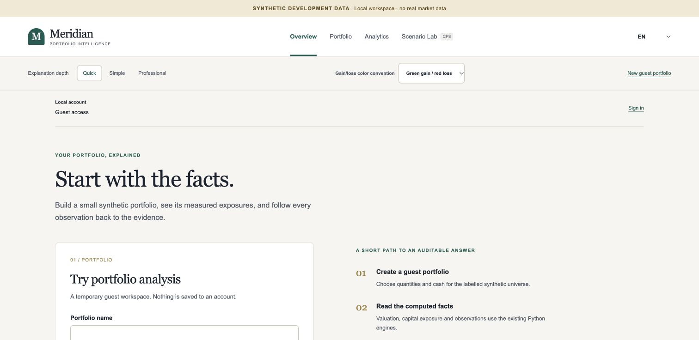

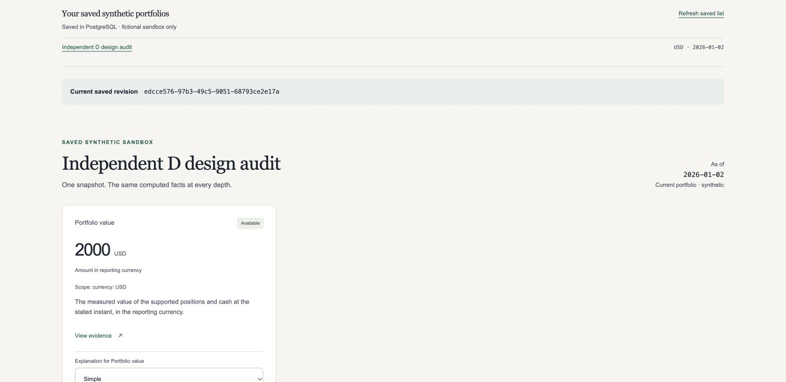

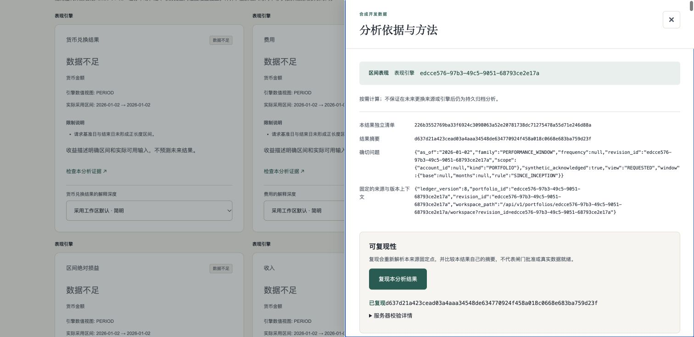

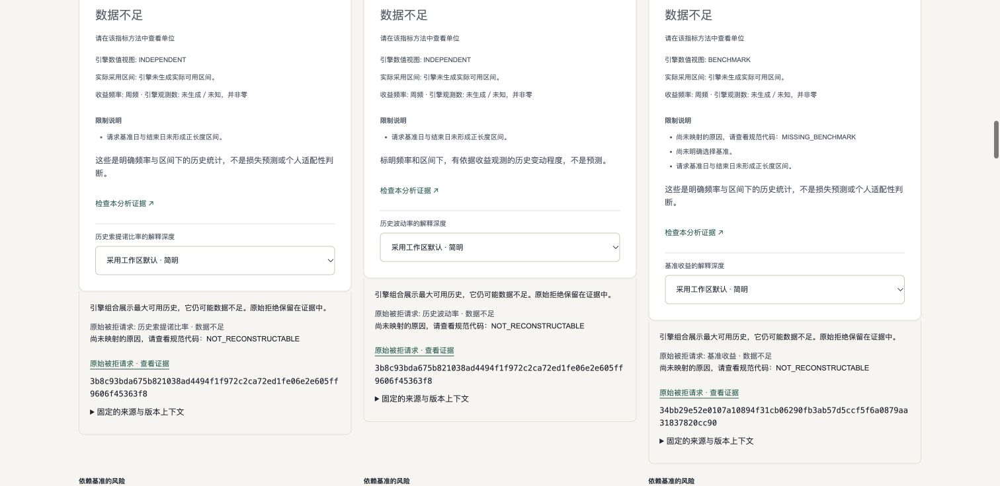

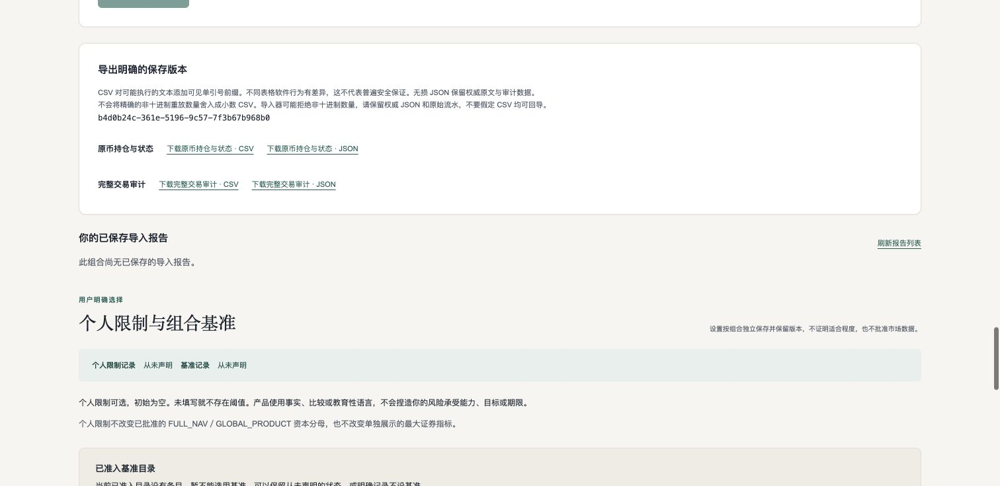

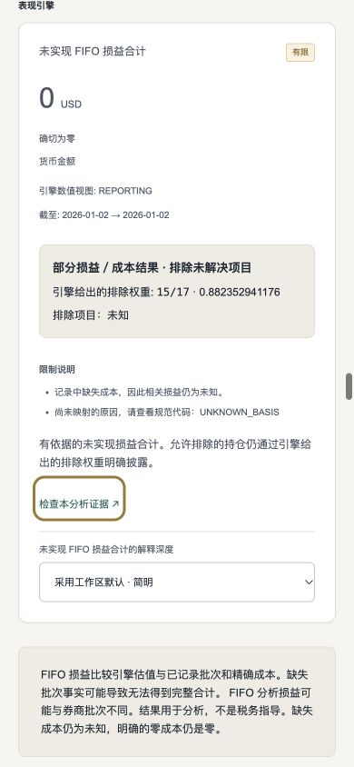

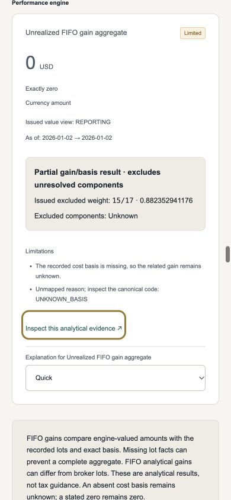

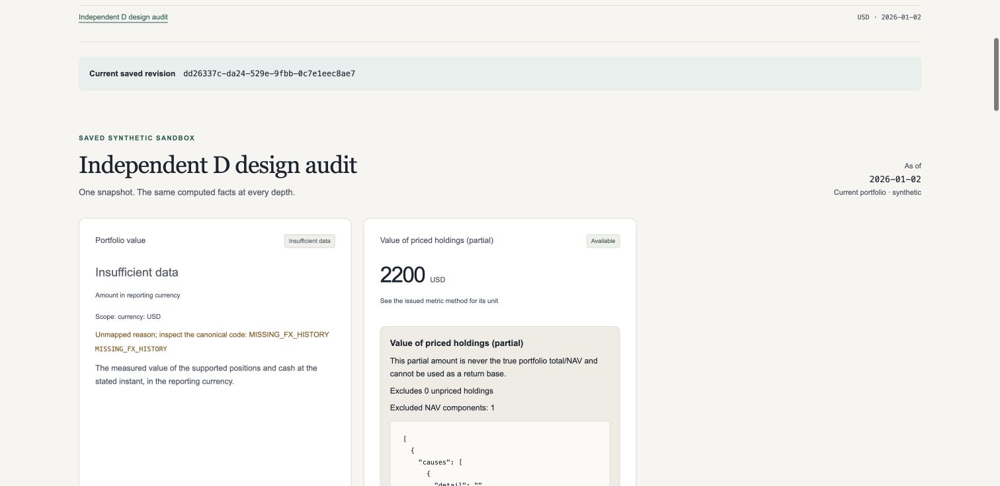

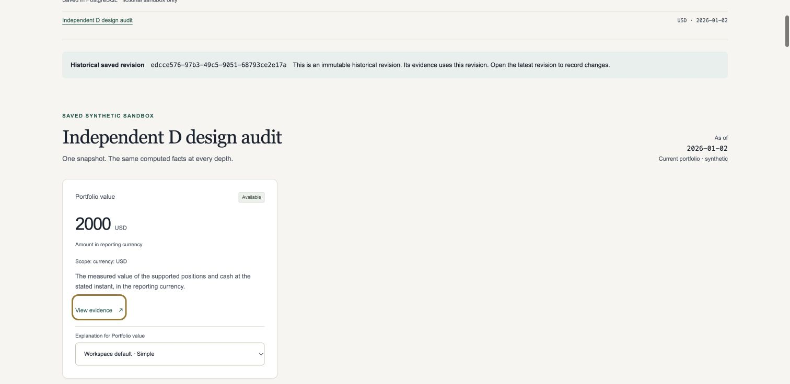

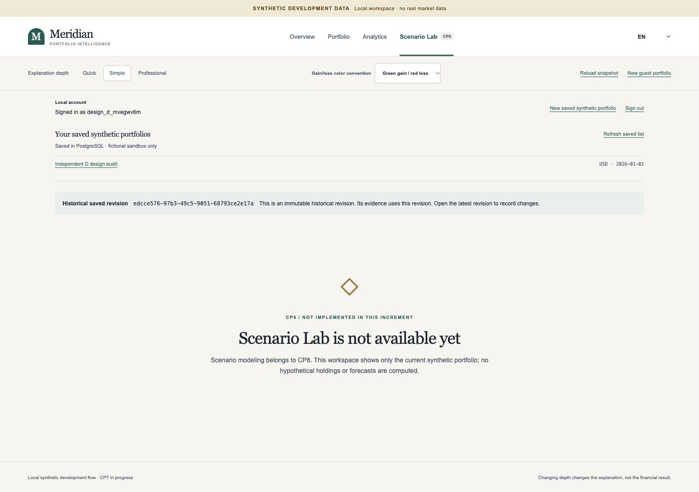

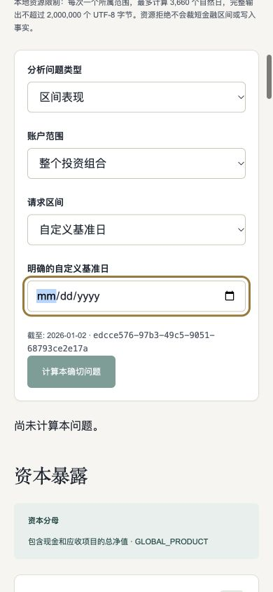

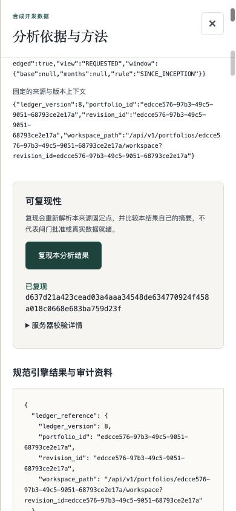

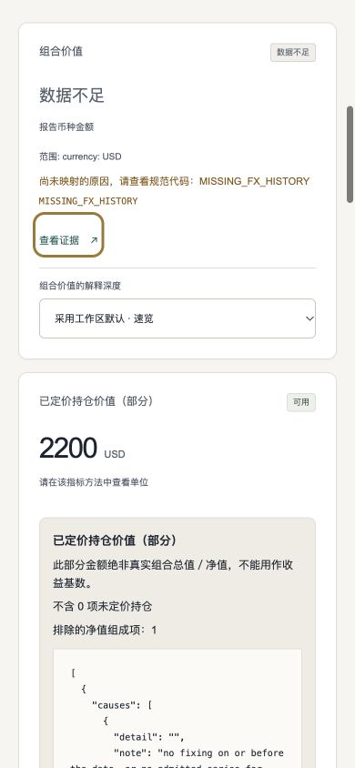

Next: author applies the bounded common-context and known-reason repairs, then
the independent designer rechecks only those changed rendered branches.
