# CP7-D independent targeted design recheck

2026-10-19, `/root/designer_cp7d`. **PASS_WITH_LIMITS: CP7D-UX-01/02/03 closed
within the affected synthetic design scope.** This is a new audit run with fresh
own captures. The first
28 JPEGs and the first HOLD report remain byte-for-byte unchanged.

Scope is only CP7D-UX-01/02/03 and their affected controls, copy, disclosures and
390px rendering. The original fourteen-step audit is not repeated or relabelled.
No real-data usability, owner HG4 decision, release or full accessibility claim
is implied by this targeted review.

## Candidate and own runtime boundary

The initial repaired candidate's 53-file inventory digest was
`21870e69673ef1c0382d65b0a31cd38e76c1714885620c0089bd529a24c9ec2f`.
Captures01–13 belong to that candidate and are individually hashed in
`pre-limitation-fix-manifest.json`. Capture12 preserves the still-untranslated
legacy `INCOMPLETE_VALUATION` observation. That observation was reported to PM
before any final closure claim. A later narrow fix requires a separately
identified candidate and new captures; none of these13 originals is overwritten.

The PM granted exclusive UI on the same private restart schema and loopback
review app. A fresh own Chrome session/tab1460642544 used exactly the last one
authorized fictional registration. There was no registration retry, quota/reset
workaround, second identity, direct HTTP/PG command, process control, real file,
download, source admission, production dependency or product-code edit here.
Only documented cua_repl UI APIs were used. IAB was already observed unavailable
in the first run, and the current grant explicitly permitted own Chrome fallback.

The new page example again supplied10A,10B and500USD; actual initial NAV was
2000USD on `c76e9188-64ab-4c4e-8416-fafc38e71feb`. Own preview/confirmation
created E recheck basis and Jan2 OPENING_POSITION2A, basis200USD, acquiredJan1;
at `7d57be5d-91a5-54af-b6b4-97b912c0689a` the UI retained known0AVAILABLE,
aggregate0LIMITED and excluded15/17. Then a new F recheck missing FX container
received Jan2 DEPOSIT10CNY, producing trueNAV insufficient and separate partial
2200USD with0unpriced holdings and1excluded CNY cash component. No market data,
cost, FX or financial convention was invented to reach those states.

All operations had their actual rolled-back preview inspected and explicit
confirmation completed. Credentials stayed in memory. After the13captures, the
own tab was parked at `about:blank` and all shared PG/HTTP/browser runtime was
explicitly released while PM arranged the final label-only repair. No application
request/HMR activity or pending write remained. The same identity/session is
retained solely for the authorized last check, without consuming another
registration. Final logout/viewport-reset/tab-close evidence is recorded in step7.

## Affected steps and observed health

1. **Shared financial context, all three depths, English and Chinese — closed
   in this observed repaired candidate.** Screens01/02 show all five complete
   material common restrictions, default-visible under an explicit scope applying
   to every following observation. The four financial restrictions were not
   deleted to reduce density. Actual DOM checks after each of six global depth /
   language selections retained12visible common-context references,12Evidence
   actions and local unknown-classification caveats. Each card keeps its issued
   scope, state and reference; there is no personalized policy substituted for
   the global product context. The local caveat does not move into a tooltip or
   Professional-only view. CP7D-UX-01 can close for this bounded synthetic flow.

2. **Known causes, English and Chinese — four cases fixed, one narrow residual
   found and preserved.** UNKNOWN_BASIS now says recorded basis is unknown and
   unknown is not zero (03/07). MISSING_BENCHMARK and NOT_RECONSTRUCTABLE have
   readable general labels and retain the actual issued selection/source detail,
   without inventing a specific cause (08/09). MISSING_FX_HISTORY now plainly
   explains that required-date FX is unavailable and no rate/converted amount
   is invented (10/13). However, the existing Overview largest-security-weight
   and effective-positions cards still emitted raw `INCOMPLETE_VALUATION` as a
   local limitation (12), despite their readable primary FX cause. CP7D-UX-02
   was not reported as all-five closed at that intermediate point. The final
   same-identity check in step7 now closes the fifth case; screen12 remains
   unchanged as the original residual evidence.

3. **Professional evidence/control density — repaired in observed behavior.**
   Screens03/07 show the aggregate name, actual0USD, LIMITED, partial label,
  15/17/unknown count, local caveats, Evidence and depth controls together at390px,
   before the long professional detail. The card still carries substantive
   inspectable detail; the goal was reachable controls, not suppressing evidence.
   Actual exact value0/1, method, own manifest/digest, requested/effective period,
   revision/ledger/scope/as-of/reporting-currency/source pins and separate freshness
   remain visible in Professional (05). The complete raw source context is a
   native SUMMARY/details disclosure (04). Enter opened it, revealing2187text
   characters including calendar and conventions, thenEnter closed it. The
   complete binding remains available without preceding the core controls.

4. **Partial valuation and complete raw exclusions — repaired in observed
   behavior.** Chinese390px screen10 and English390px screen13 contain the full
  2200USD partial claim, explicit reporting-currency amount unit, notNAV/notreturn
   base caveat,0unpriced holdings,1excluded NAV component, CASH/CNY/native10,
   readable FX cause, evidence and depth controls. They do not replace the true
   suppressed total. The original excluded record is retained in a native
   disclosure (11); Enter opened it, including the original CNH/CNY note and
   exact source fields, thenEnter closed it. Chinese card measuredabout709px and
   English744px at an actual390x844viewport, compared with the prior raw929px
   card. Both preserve material facts rather than replacing them with an icon.
   CP7D-UX-03 can close for the observed control/disclosure changes.

5. **Keyboard, focus and actual reproduction — healthy in the affected path.**
   Enter activated the now-fronted gains Evidence action. Its own revision-bound
   result actually returnedREPRODUCED (06), digest
   `d14b8f9195e22395808b8d5cc0ff853182abd0e3c7b00c099095d8f3f019842d`.
   Shift+Tab remained inside the nativeDIALOG; Escape closed it and restored the
   exact Evidence opener. Native details were keyboard-operable in steps3/4.
   Screens03/07/10/13 show the visible return-focus ring and wrapped controls.
   This is not a complete screen-reader, contrast or WCAG compliance assessment.

6. **Native custom date/resource refusal — NOT_EXECUTED by this designer,
   unchanged limit.** The first run's Cua date-control blocker remains recorded.
   It was not retried or bypassed here. PM and the independent technical reviewer
   report separately authored actual Playwright custom2010date, resource422,
   EN/zh refusal and recovery coverage. Their evidence is not recast as my own
   manual execution or used to erase the original tool limitation.

7. **Final legacy limitation mapping and cleanup — passed the affected UI
   check.** PM supplied an explicit exclusive runtime grant on the53-file final
   inventory `candidate-final-known-reason-code-hashes.json`, SHA-256
   `5a57190d41bdf8df7c6286e765bb1f3865a2934ed995aa35443169d3ce411ca8`.
   The same own tab/cookie resumed fromabout:blank, without another registration
   or login attempt. The owned latest revision was
   `02c6603d-a6e6-5f62-b7d0-c0fb8f0b1b96`. Both largest-security-weight and
   effective-positions cards now showed a readable local limitation:
   “A complete valuation is unavailable, so its dependent metrics remain
   unavailable. A separately labelled partial amount is not the portfolio
   total/NAV.” Chinese cards showed the corresponding plain explanation. The
   readable primary FX cause and insufficient state stayed visible; no number
   was manufactured. ActualDOM checks of both local listitems inEN/zh×Quick/
   Simple/Professional retained that explanation. New14/15capture both exact
   cards inEnglish/Chinese;16verifies390px wrapping. Candidate and exact-byte
   hashes are separately recorded in
   `final-limitation-fix/screenshot-manifest.json`;01–13were not overwritten.
   CP7D-UX-02 can now close across all five known cases observed in this recheck.
   New17records final logout: Guest status was visible and the private portfolio
   name,2200partial and15/17weight disappeared. The viewport override was reset,
   only own tab1460642544closed, temporary credentials cleared, and all runtime
   explicitly released. No financial write remained pending.

## Current captures

All13originalJPEGs were saved with `.jpg`, read back from exact local bytes and
visually inspected. The first manifest records their dimensions, hashes and
candidate. Representative accepted evidence follows;12 is a deliberately retained
residual finding, not a green acceptance image.

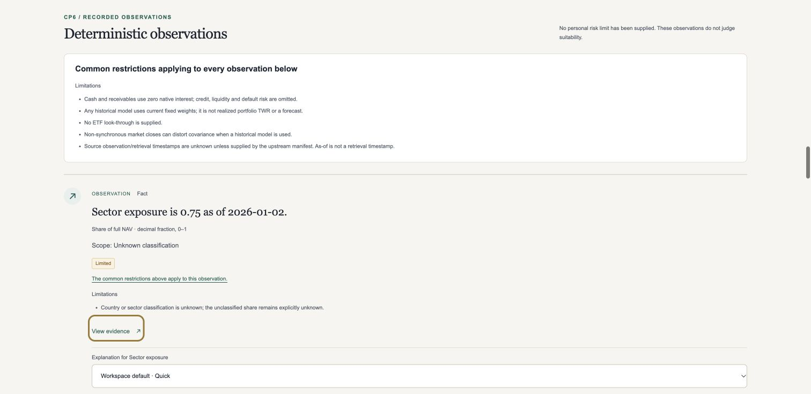

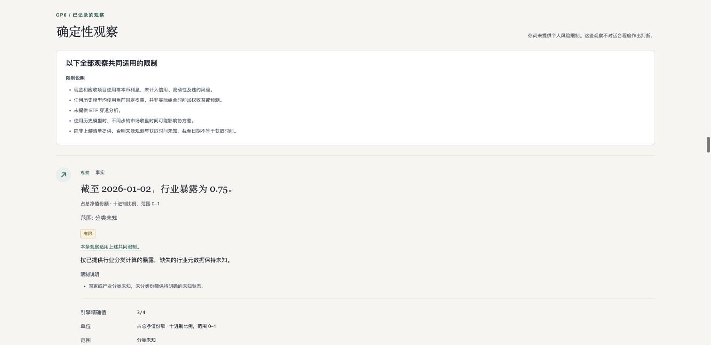

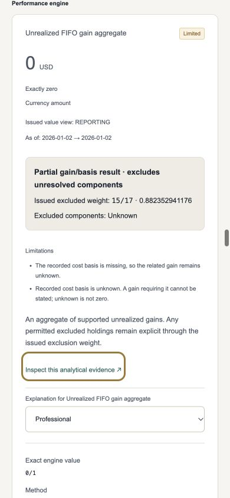

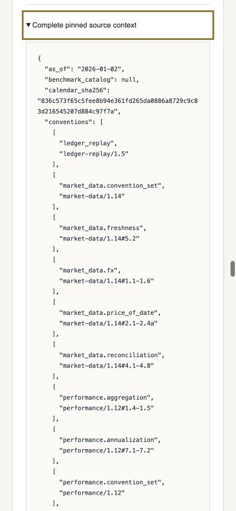

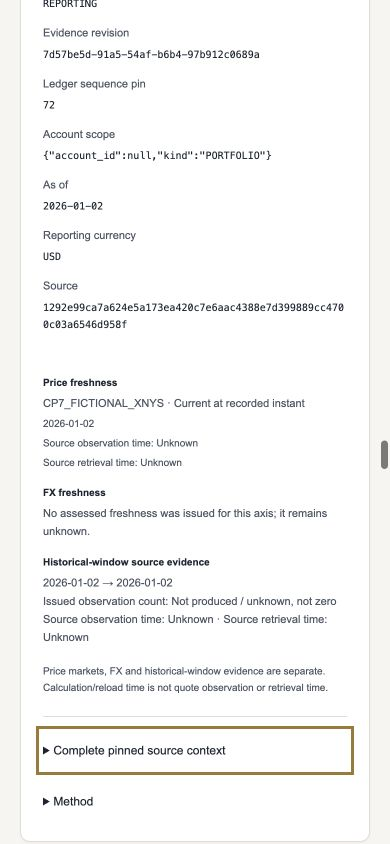

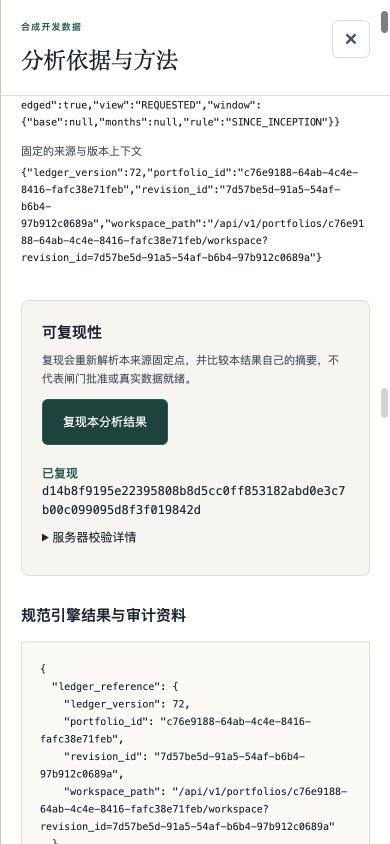

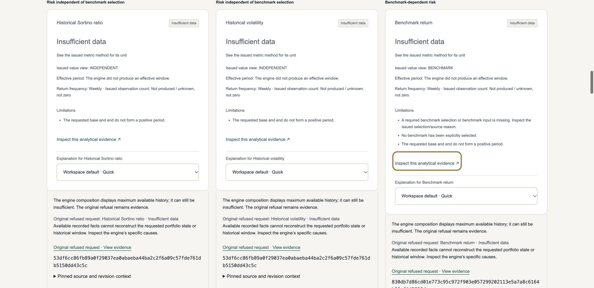

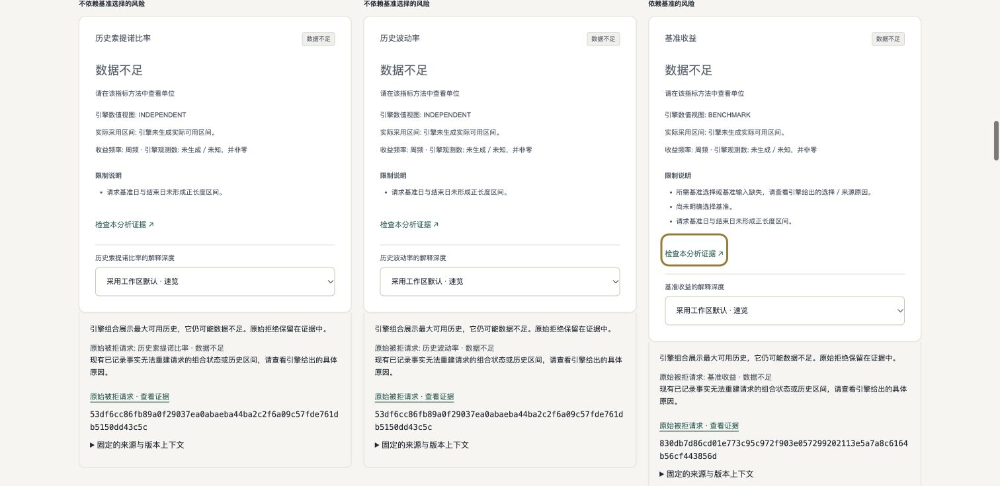

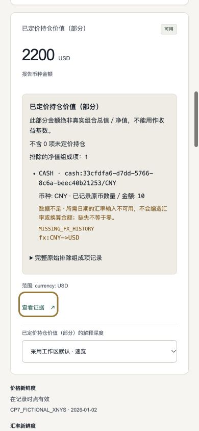

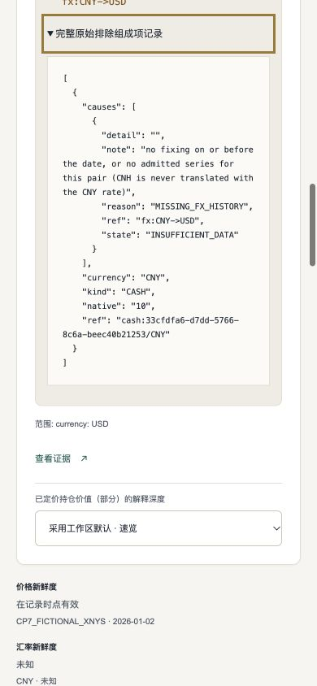

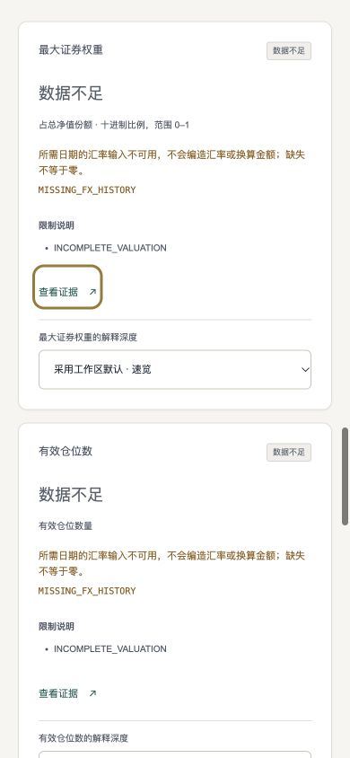

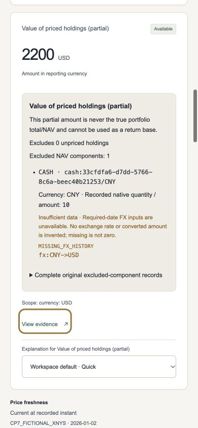

## Final narrow-fix captures and disposition

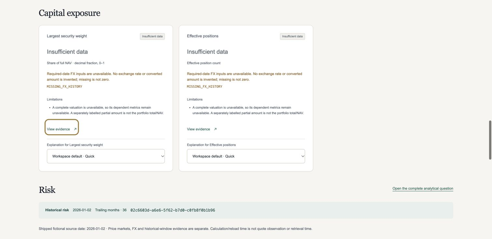

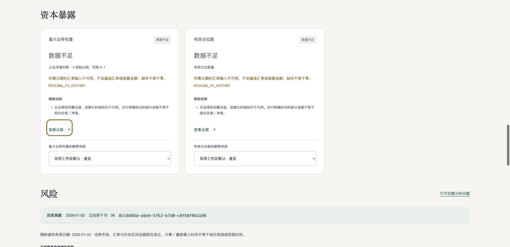

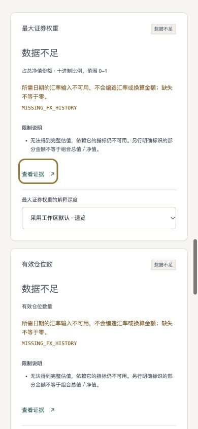

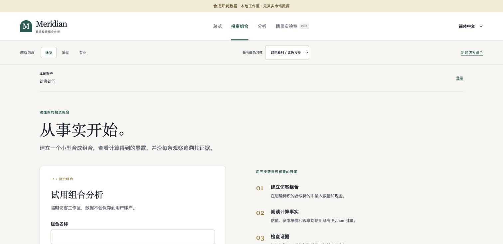

The final disposition is **PASS_WITH_LIMITS** for the three affected design
findings. The original issues are closed by the observed shared context,
cause labels, control placement and complete disclosures. The first-run HOLD,
28captures and intermediate13captures/raw residual remain intact.
`observed-depth-and-local-label-checks.json` records the six actual language/depth
checks for shared context, final12local-card checks and actual logout-clearing
predicates, without credentials.

Limits remain: no designer-native custom-date/resource-refusal pass, no full
accessibility certification, no new claim about every financial branch, no
real-data usability/source admission or owner gate. PM/technical automated tests
retain their real separate authorship. No new product/methodology choice is
raised. PM can use this bounded design closure as one input to final checkpoint
review; only the owner decides retained gates.
