# CP7-E1 independent design audit

**PASS_WITH_LIMITS for E1 design review.** The actual page keeps requested market
data separate from the uncreated non-personal test ledger, explains why all real
financial actions are disabled, and preserves a working synthetic flow. One LOW
keyboard focus-continuity observation remains. This is not real-data UAT, CP7-E
completion, E2/source qualification, or HG4 approval.

The distinct designer captured this run on 2026-10-19, 14:29–14:35 Shanghai, using
only the documented Cua Chrome API for UI actions. Nineteen captures were saved
with exclusive creation and each saved file was opened with the image viewer.
All are original JPEG bytes; the first filename extensions assumed PNG and were
corrected to `.jpg` without changing bytes. There is no replacement screenshot,
image editing, prior-evidence reuse, or borrowed author capture.

## Source and runtime binding

- Governed by [PD-0046](../../decisions/product/PD-0046-cp7e-real-source-web-integration-and-scoped-data-checks.md),
  [E1 technical plan](../../implementation/CP7_E_TECH_PLAN.md), and root's frozen
  frontend E1 phase1 contract. The current task remained E1 gate-only.
- Independently verified the authorized
  [web49 inventory](../../reviews/CP7_E_EVIDENCE/validation/web-freeze-e1-phase1.json)
  at the initial review checkpoint and after UI actions: **49 exact matches,
  zero mismatches** both times. The initial local hash check followed the first
  English Quick/retry observations and preceded the remaining depth/locale/mobile
  matrix; root supplied the frozen inventory before granting the runtime slot.
  Inventory SHA-256:
  `fcbf39c47f1403246d137c96a7c4cbd2c7c2fd13478a3b4738817dd1dd959efb`.
  No full candidate inventory or old market-data payload was read or rehashed.
- Root provided the single review runtime: Vite `:5173/session45070`, API
  `:8000/PID11769/session95255`, schema `finweb_cp7e_review19`, after its own PG/API
  restart check. These process/schema facts are **root-attributed**, not this
  designer's PG/process verification. The designer performed no direct API/PG
  action, process control, installation, download, or external-data access.
- Exactly **one** new fictional account was registered. Its username, password
  and cookie were not saved in evidence. Exactly one synthetic portfolio was
  saved and analyzed to check compatibility; no real portfolio was created.

## Actual steps and health

| Step | Action and observation | Health | Own screenshot |
|---|---|---|---|
| 1 | Open `/portfolio` as guest. Sign-in explanation says account-only readiness; fictional guest creation remains available. No guest readiness entry appears. | PASS | 01 |
| 2 | Create the one authorized fictional local account. Initial signed-in page shows synthetic creation, not a readiness result. Tab from the saved-synthetic entry reaches readiness; Return explicitly opens it and focuses its heading. | PASS | 02–03; registration credentials intentionally uncaptured |
| 3 | EN Quick, Simple and Professional retain both requested-source warnings, all three blockers, zero approved contexts and disabled create/save/analyze. Simple adds the metadata-versus-finance explanation; Professional exposes the complete public response. | PASS | 02–07 |
| 4 | Inspect the actual Professional disclosure: schema `finweb.cp7.real_source/1`, `E1_GATE_ONLY`, `BLOCKED`, `METADATA_ONLY`, approved count `0`, empty contexts; all financial capabilities false. Only `source_metadata` is true. Personal holdings, data admission/download, real UAT and HG4 flags are false. | PASS for rendered response | 05–07 |
| 5 | Switch to Chinese Professional, Simple, then Quick. Both provenance statements, the three blockers, disabled action explanation and translated action labels remain present at every depth. | PASS | 08–10 |
| 6 | Set the documented viewport override to 390×844. In both languages, actually scroll from the upper provenance section through the entire blocker box to all three disabled controls, retry and return actions. Long identifiers wrap within the card; content and actions remain reachable. | PASS | 11–14 |
| 7 | Tab skips the three disabled real financial buttons and reaches retry; next Tab reaches the fictional return action with a visible focus ring. Activate retry by keyboard twice during this run; valid blocked content returns. After retry, focus is BODY; next Tab still reaches the return action. | PASS WITH LOW observation UX-E1-01 | 03, 15, 18 |
| 8 | Return by keyboard to the fictional saved-portfolio flow. Use example quantities, explicitly acknowledge synthetic inputs, save and analyze. The resulting overview visibly says SAVED SYNTHETIC SANDBOX, shows the test name and server-produced `2000 USD` snapshot, with synthetic date and freshness caveats. | PASS for this bounded compatibility path | 16–17 |
| 9 | Explicitly reopen readiness, leave Portfolio for Overview, and return to Portfolio. The readiness panel/banner closes; returning does not silently reopen it. Explicitly opening readiness again restores only the blocked E1 view. | PASS | Current-run AX observations; 18 shows final reopened/retried panel |
| 10 | Sign out from readiness, then reload. Guest access and its explanation return; readiness and saved-account content are absent. Viewport override was reset. Attempt own tab close and one inventory confirmation; bridge fails both, so final disappearance is unknown. | Logout PASS; tab cleanup UNCONFIRMED | 19 |

The real readiness view contains no quantity, date, cost, ledger or personal-holding
input form. Direct read-only DOM inspection confirms the create, save and analyze
buttons each have `disabled=true`. This is UI evidence; it does not replace a
server no-write or network-request trace.

## Finding

**UX-E1-01 — LOW: retry completion drops active focus to the page body.**
Starting from the focused readiness heading, Tab reaches “Check readiness again”
and shows a strong visible focus ring (03). Return triggers an actual retry;
after the blocked result appears, the documented read-only DOM observation is
`{activeTag: "BODY", activeId: ""}` and the ring is absent (18). This happened
twice. The next Tab correctly reaches “Use the fictional saved-portfolio flow,”
so no navigation reset or keyboard trap was observed. A future focused adjustment
could return focus to retry or the updated readiness heading after the result.
This is a minor focus-continuity issue, not evidence that finance was enabled.

## Errors, omissions and attribution

- **Observed product/runtime UI:** normal blocked readiness returned on entry and
  on two actual retries; no unexpected UI error was observed. The Cua tab's
  warning/error console read returned an empty list. The ordinary blocked state
  visibly says “Source not ready” and names the three unavailable capabilities.
- **Own fault injection — NOT_EXECUTED.** The documented Cua surface supplied no
  `route.abort`; no network control was invented or attempted. Thus this reviewer
  does not independently certify network-error, invalid-response or in-flight
  logout race recovery. Root reports controlled-abort recovery was actually run
  by author and independent technical reviewer; that remains their evidence.
- **Own HTTP trace/no-write/PG checks — NOT_EXECUTED.** Actual UI reads were
  triggered only through explicit readiness/retry controls. This designer did not
  capture network request counts, issue a real POST refusal probe, or inspect
  database rows. Zero-financial-request and unchanged-row claims require the
  separately attributed technical checks. Disabled buttons and the rendered
  all-false response are the bounded evidence here.
- **Tool cleanup failure:** after confirmed logout/reload and viewport reset,
  documented `tab.close()` returned `native pipe is closed`; a single
  `listTabs` confirmation failed with the same bridge error. Final disappearance
  of own tab `1460642656` is **UNKNOWN**, not claimed closed. Root was informed
  and the exclusive runtime slot was released; no further UI action followed.
- No screen reader, contrast measurement, zoom matrix, response-error injection,
  configured-descriptor variant or second identity was tested. The mobile checks
  were Quick in both languages; the complete EN/zh × three-depth matrix was
  checked at the normal 1200×671 viewport. These checks do not establish full
  accessibility compliance or real-data usability.

## Screenshot record

Every file below was saved and individually opened. Sequential viewport captures
overlap to cover long content; upper and lower mobile views are both this
reviewer's actual run. [image-manifest.json](image-manifest.json) records exact
file hashes, byte sizes, dimensions and capture times; [run-record.json](run-record.json)
records the observed actions and limits without authentication material.

Final artifact checks found 19/19 image hashes exact, 19/19 report images and all
five local document links present. A narrow credential-pattern scan of this
folder's text files found no review username, password prefix, bearer token or
session/CSRF literal. The change consists only of this new 23-file untracked
audit folder; tracked-file `git diff --stat` for the folder is empty.

1. Guest entry — PASS.

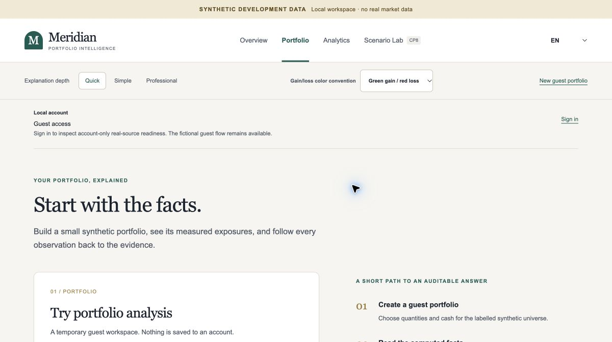

2. English Quick, provenance and blockers — PASS.

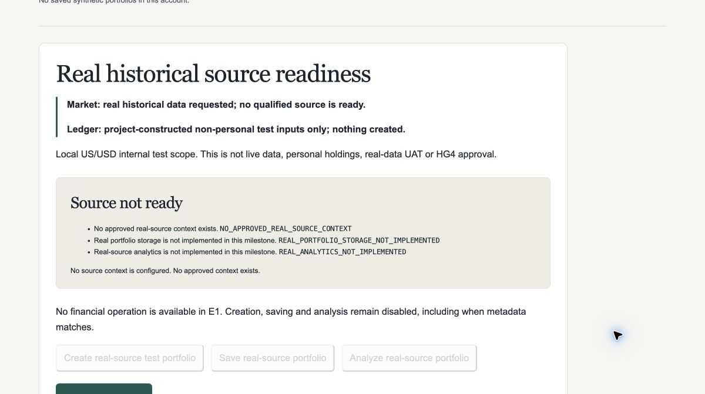

3. English Quick, disabled actions and retry focus — PASS.

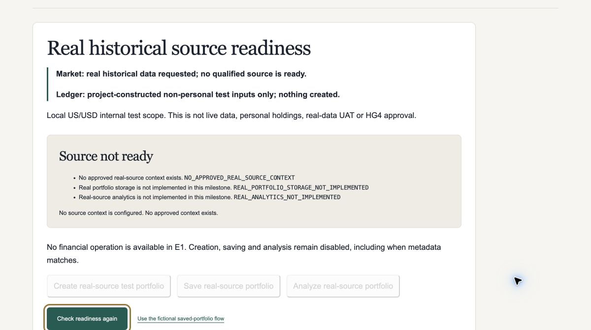

4. English Simple lower panel — PASS.

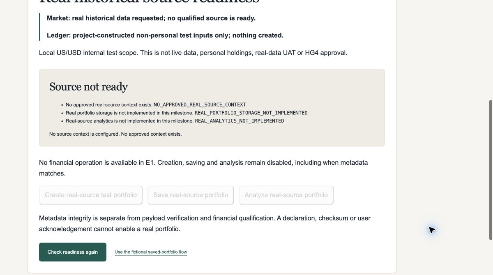

5. English Professional expanded disclosure — PASS.

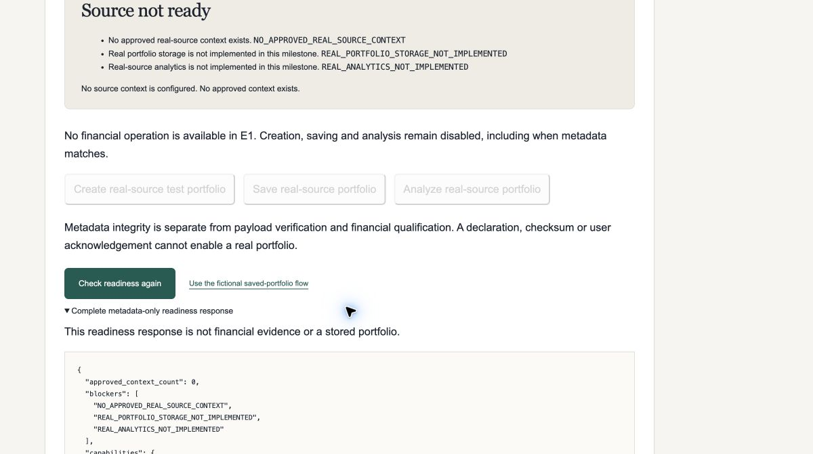

6. Actual disclosed capability flags — PASS for rendered response.

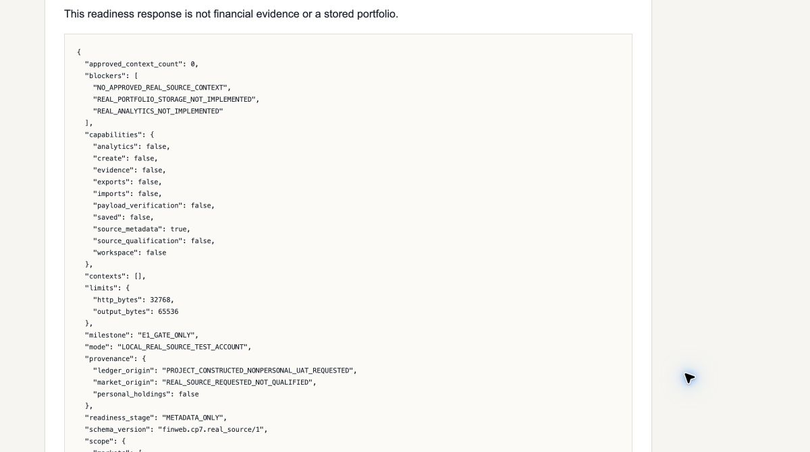

7. Actual disclosed metadata stage, scope and approval flags — PASS for rendered response.

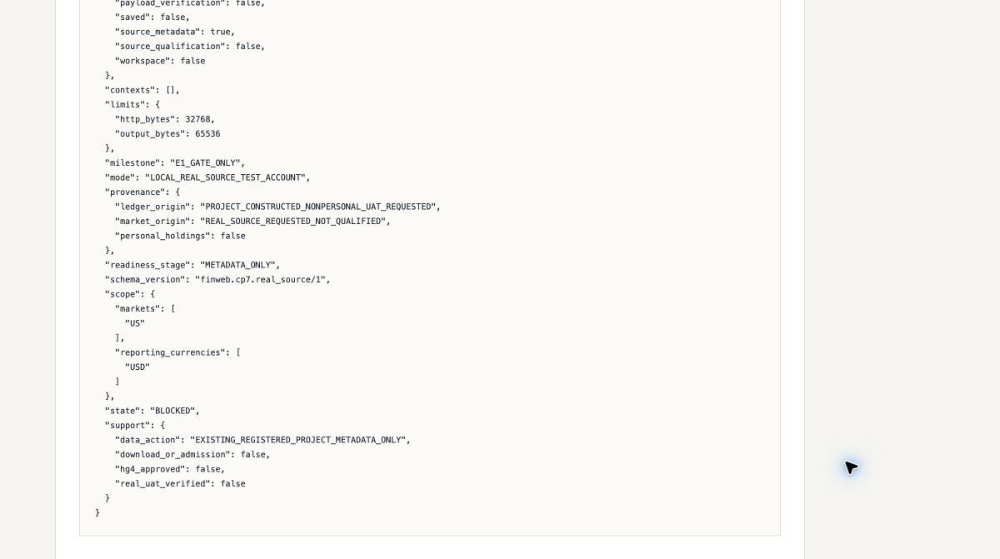

8. Chinese Professional panel — PASS.

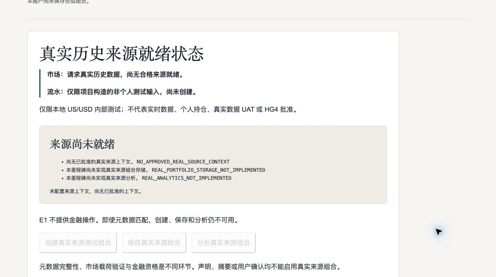

9. Chinese Simple panel — PASS.

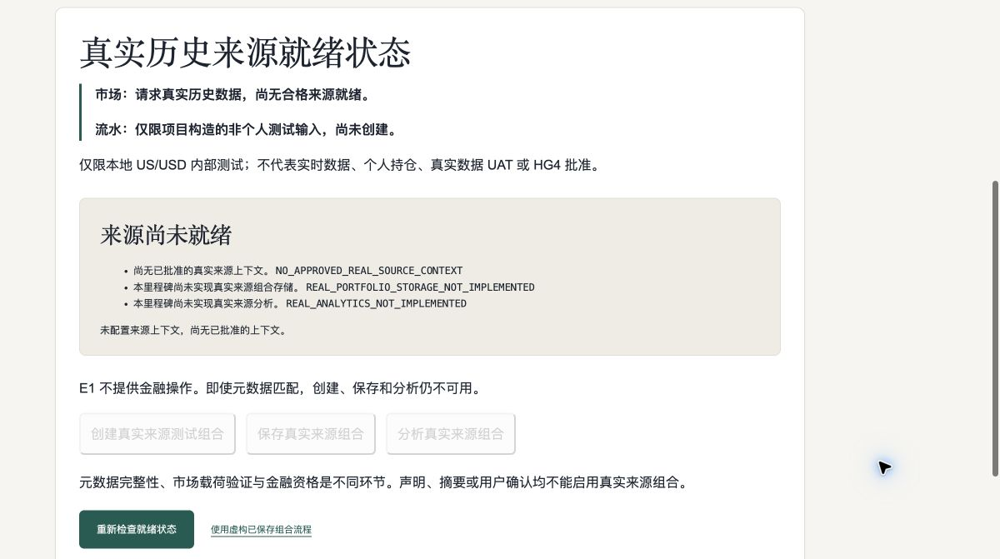

10. Chinese Quick panel — PASS.

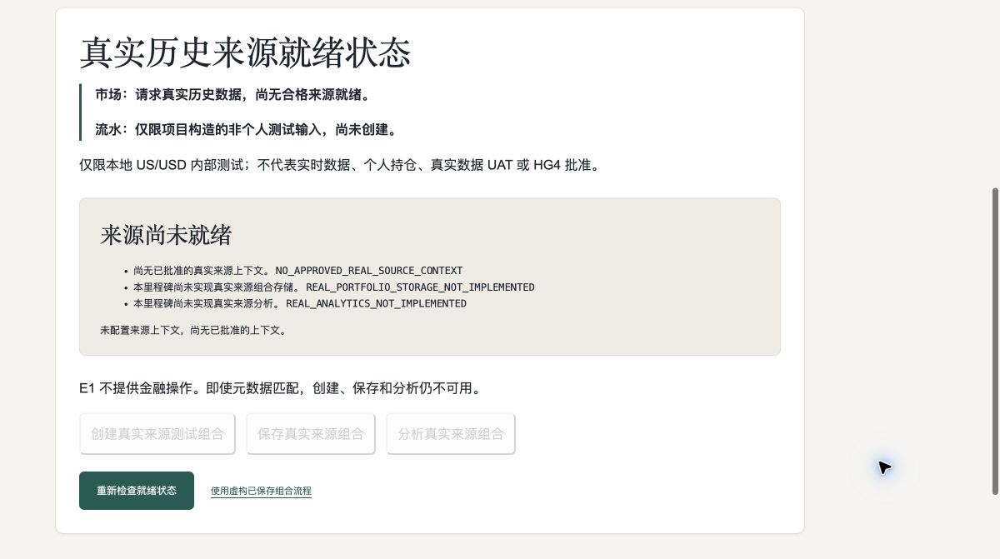

11. Chinese 390px upper scroll position — PASS.

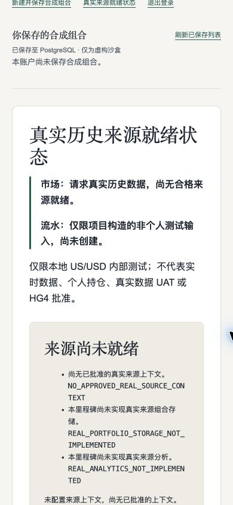

12. Chinese 390px lower position, complete blockers and actions — PASS.

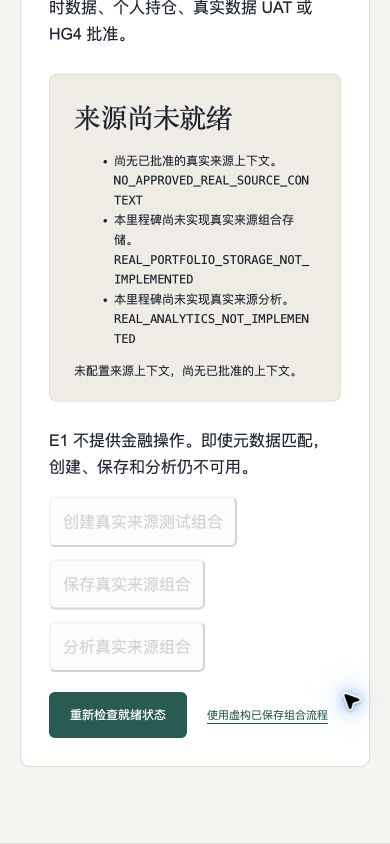

13. English 390px upper position — PASS.

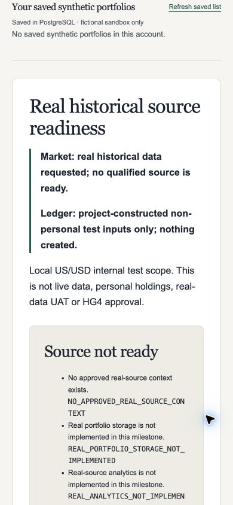

14. English 390px lower position, complete blockers and actions — PASS.

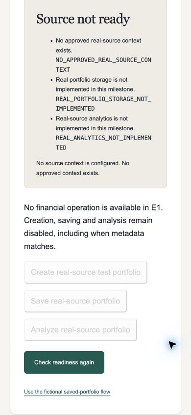

15. Mobile return action with keyboard focus — PASS.

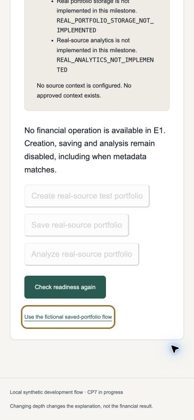

16. Synthetic example and explicit acknowledgement — PASS.

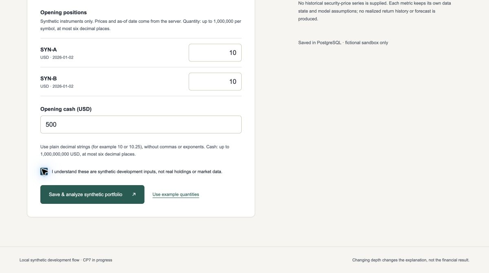

17. Actual saved synthetic analysis result — PASS.

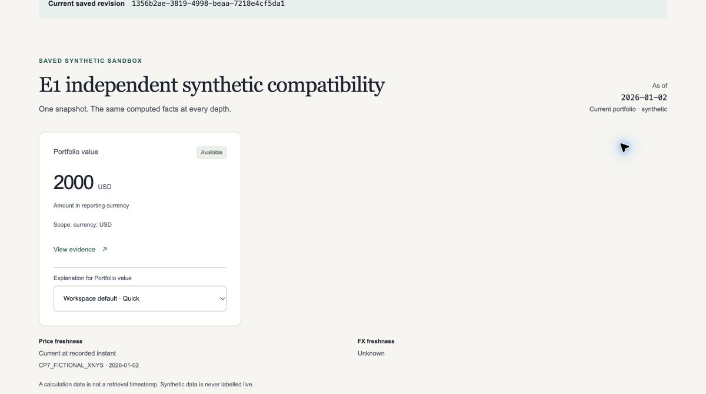

18. Actual blocked retry result without retained active focus — LOW UX-E1-01.

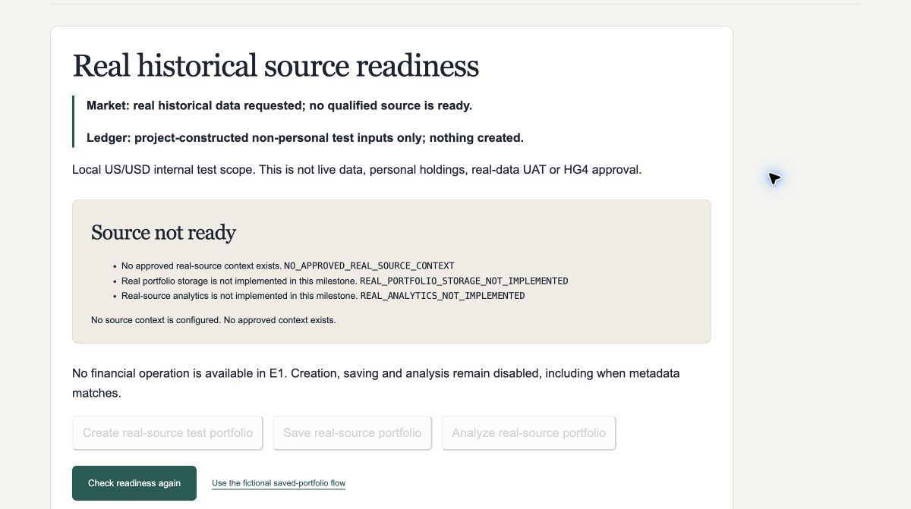

19. Guest state after actual logout and reload — PASS.

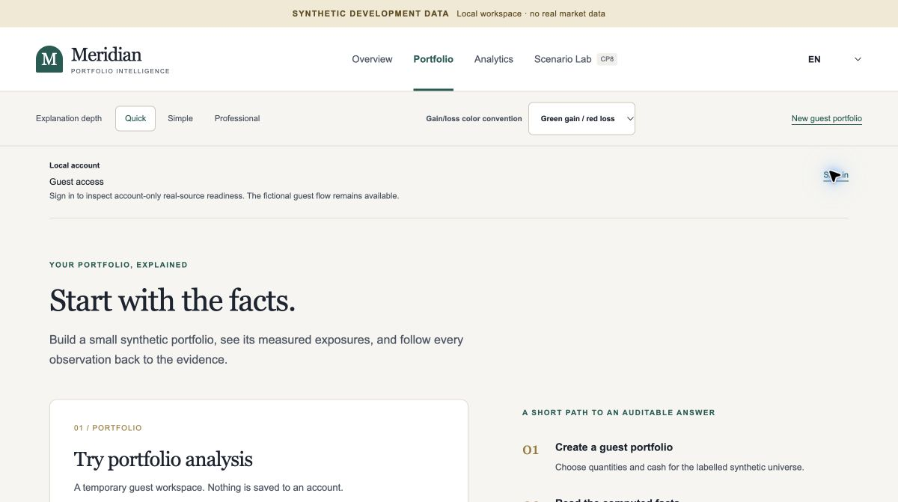

Root can combine this bounded design evidence with the independent technical
record for E1 PM disposition, retaining UX-E1-01 and the explicit unexecuted checks.
