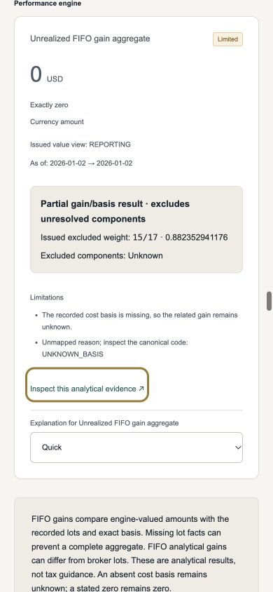
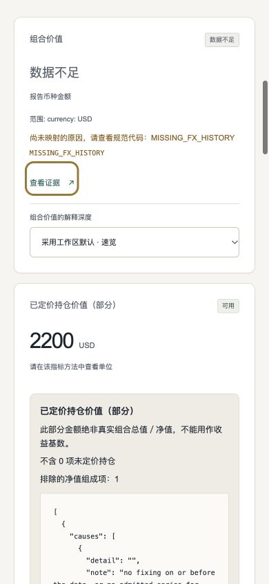
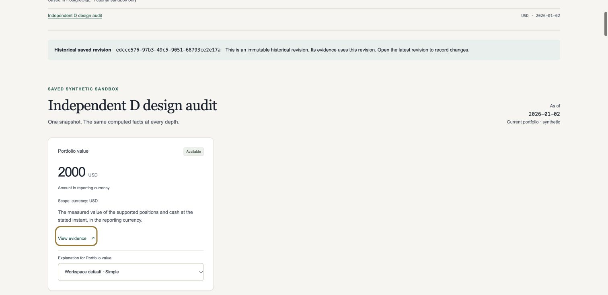
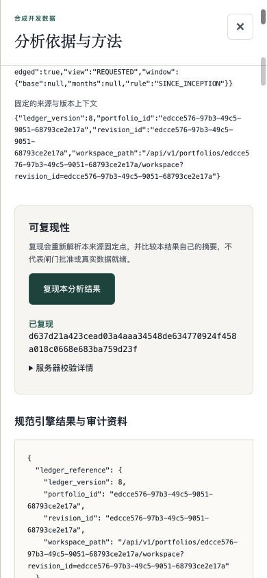
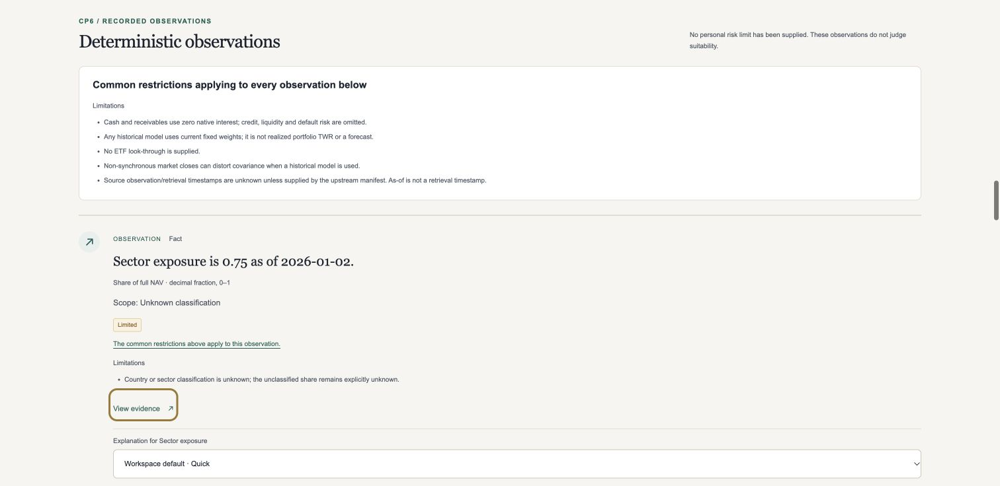

# Design Review — Increment 1: Product Contract and Architecture Proposal (CP0)

**Increment ID:** `INC-001`
**Task:** `feature-development/design_review`
**Reviewer:** `designer`, worker `designer-02`, 2026-09-04
**Under review:** `designs/FEATURE_DESIGN.md` (authored by `designer-01`); `src/product_contract/`
and `tests/product/` (authored by `engineer-02`), reviewed against the design contract only.
**Not under review here:** code quality of `src/`/`tests/` (that is `technical_review`'s), and
`reviews/TECH_REVIEW.md`, which a concurrent worker (`review-01`) owns.
**Review question (per `specs/FEATURE_PRD.md` §3.4):** could a competent stranger execute the
next increment from these artifacts, and does the proposal actually satisfy P1–P12?

I did not author `designs/FEATURE_DESIGN.md`. I am treating it as someone else's work and have
not edited it or any other artifact besides this one.

---

## 0. Headline

**Two blocking findings, both centered on the same fact: D3's presentation contract was
authored against a reading of the metric-state model that `decisions/product/PD-0006` later
amended, and the amendment invalidates a specific, load-bearing sentence in D3.2 — not merely a
risk noted in D3.5.** `src/product_contract/metric_state.py` correctly implements the amended
model and pins it with a dedicated, passing test. The design does not. A third, related finding
concerns AC-07's reachability argument. All three are detailed below with evidence.

---

## 1. Blocking findings

### BF-1 — D3.2 asserts a combination that PD-0006 (amended) and the implementation both require to exist (AC-06, AC-07 §7 item)

**Claim under test:** AC-06 — "every metric state has a specified rendering… none of them
renders as zero, blank, or a fallback value," verified under the now-decided layered model
(OQ-01 is CLOSED; `designs/FEATURE_DESIGN.md` §D3.5 explicitly reduces to "a record of a path
not taken").

**Finding: NOT SATISFIED, blocking.**

`designs/FEATURE_DESIGN.md` §D3.2's rendering table states, for reason codes generally:

> "Attaches as the explanatory clause on whichever sufficiency state it modifies (per D3.1,
> always `LIMITED` or `INSUFFICIENT_DATA` — **a reason code never modifies `AVAILABLE`, since
> if there were a live blocking reason the metric could not be fully available**)."

`decisions/product/PD-0006-metric-state-vocabulary-is-layered.md` was **amended on the same
day**, after `implement`, specifically to reject this reading:

> "**`AVAILABLE` + `STALE_DATA` remains a valid, expected combination.**"

And `src/product_contract/metric_state.py` implements exactly the amended reading: it
deliberately does **not** couple `reason_code` to `sufficiency_state`, with a module docstring
explaining why (`"AVAILABLE" + stale is a real, expected case… not an edge case to be typed
away`). `tests/product/test_metric_result.py::StaleDataNarrowingTests` pins this with two tests,
including one constructing `MetricResult(value=1.30, sufficiency_state=AVAILABLE,
reason_code=STALE_DATA)` and asserting it **succeeds** — the comment reads: "AVAILABLE + a value
+ STALE_DATA is exactly the… case PD-0006 says must remain representable."

So there is a real object the implementation constructs, tests, and expects to exist —
`AVAILABLE` carrying a value and a `STALE_DATA` reason code — for which **D3.2 has no rendering
rule**, and which D3.2's own stated logic ("a reason code never modifies `AVAILABLE`") would
lead an implementer to treat as a bug or an impossible state rather than the expected case the
product-contract decision requires. This is not the OQ-01 dependency D3.5 already flags — D3.5
was written against the *pre-amendment* wording and correctly says D3 "needs no rework" for the
sufficiency/reason-code *shape* question. It says nothing about this specific combination,
because the gap it needs to close was identified only later, in the same PD-0006 document's own
amendment note (attributed to `engineer-02`, not to the designer).

Whether this is "unrendered" because it's covered implicitly by D5's freshness axis rather than
by a D3 numeric-state rule is genuinely ambiguous from the text: D3.2's `AVAILABLE` row does say
the value renders "with reference point (P4) and freshness (D5) attached," which is *consistent*
with the amended model if freshness is read broadly enough. But D3.2's very next row forecloses
that reading by asserting the combination cannot occur at all, and D5.3 independently states
that `STALE_DATA` "overlaps with §32's `STALE_DATA` reason code **when it causes a metric to
degrade to `LIMITED`**" — i.e., D5's own author also assumed `STALE_DATA` only ever appears on a
demoted metric, never on an `AVAILABLE` one. Both D3 and D5 were written under the same now-false
assumption; neither has a stated rendering for `AVAILABLE` + `STALE_DATA` with a value present.

**Why this is blocking rather than a note:** §3.4 of `specs/FEATURE_PRD.md` frames the review
question as whether "a competent stranger" can execute the next increment from these artifacts.
An implementer building the UI from D3.2 literally, encountering an `AVAILABLE`
`MetricResult(value=1.30, reason_code=STALE_DATA)` object (which the product contract now
guarantees will occur, routinely, given P10/NFR-008's "cross-market prices are never
simultaneously real-time"), has no design guidance and a design sentence that says the object
they are holding cannot exist.

**Recommendation (reported, not fixed by me):** D3.2 needs a fourth row — or an explicit
amendment to the `AVAILABLE` row — specifying how `AVAILABLE` + `STALE_DATA` renders (most
likely: the plain numeric render plus the D5 freshness indicator, with **no** additional D3-style
qualifier, since PD-0006 is explicit that ordinary staleness must not degrade to `LIMITED`'s
treatment). The sentence "a reason code never modifies `AVAILABLE`" should be struck.

### BF-2 — AC-07's "reachable from every claim-bearing surface" argument is not backed by D1 for Scenario Lab (and is asymmetric across surfaces)

**Claim under test:** AC-07 — "The path from a displayed claim to its evidence is specified and
reachable from every surface that displays a claim." The stated test is a single traced
surface, which D4.3 provides (Performance). The document's own §D4.4 self-check goes further and
asserts reachability is "structurally present on every claim-bearing surface listed in D1
(Overview, Holdings…, Performance, Exposure, Risk & Analytics, Insights, Scenario Lab, AI
Analyst)" — this is the claim I tested, per the review brief's specific instruction to check "AI
Analyst and Scenario Lab especially."

**Finding: partially NOT SATISFIED — AC-07's literal test (one traced surface) is met; the
broader reachability argument the document itself makes is not evenly supported and fails for
Scenario Lab specifically.**

Checking each claim-bearing surface's own D1 entry for an explicit statement that the D4
evidence-affordance control is attached:

| Surface | D1 states D4 control is present? |
|---|---|
| Overview | No — hierarchy item 9 mentions freshness disclosure, not an evidence affordance. |
| Holdings | No — item 3 names D3 (metric-state), not D4. |
| Performance | Not in D1's own hierarchy list, but explicitly and fully traced separately in D4.3. |
| Exposure | No. |
| Risk & Analytics | **Yes**, explicitly: "Methodology link (D4) on every metric card." |
| Insights | **Yes**, explicitly: "an evidence affordance (D4) to the Proof Packet." |
| Scenario Lab | **No.** Surface 7's four-item hierarchy covers the P8 separation mechanism, scenario controls, the comparison table, and D3 metric-state carryover — it never mentions D4 or an evidence-affordance control anywhere in its own section. |
| AI Analyst | **Yes**, explicitly: "Evidence affordance (D4) on every material claim." |

Scenario Lab is the clean counterexample the review brief pointed at: it is one of the most
claim-dense surfaces in the document (a full current-vs-scenario metric comparison, §D1 item 3),
its own section discusses P8 labeling requirements in detail, and yet it is the one surface whose
own text never asserts the evidence path exists. AI Analyst, by contrast, states it explicitly
and is not a counterexample.

Overview, Holdings, and Exposure share the same gap, but are lower-severity: Overview and
Holdings are explicitly noted elsewhere as aggregating claims from other surfaces (D1
cross-cutting notes), so an evidence affordance reachable via the underlying metric's own primary
surface may be an implicit, defensible design (though the document never says so). Scenario Lab
has no such "claims live elsewhere" escape — its comparison table is the primary and only
presentation of scenario-specific metrics, so if D4 doesn't reach it there, it doesn't reach it
anywhere.

**Why this matters against P9 specifically:** P9 requires every important insight/claim be
auditable. A Scenario Lab comparison explicitly carries D3 metric states (per its own §D1 item
4) and is exactly the kind of claim P9 exists to cover — a `LIMITED` beta shown in a scenario
comparison needs the same evidence path as one shown on Risk & Analytics, and nothing in this
document establishes that it has one.

**Recommendation (reported, not fixed by me):** either D1's Scenario Lab section needs an
explicit D4 line matching Risk & Analytics/Insights/AI Analyst's pattern, or D4.4's self-check
needs to be narrowed to the surfaces it actually supports and the gap logged as an open item
rather than asserted as closed.

---

## 2. Non-blocking findings

### NF-1 — AC-05/D2: the caveat-preservation mechanism guarantees slot non-emptiness, not meaning preservation, and no verification checkpoint is named

D2.2 states the caveat field is "never optional and never dropped," compressed by a per-level
word budget rather than a content-selection rule. This is a real structural guarantee against
one failure mode: a template that simply has no caveat slot at Quick depth, so an author
"forgets" the caveat. It is **not** a guarantee against the failure mode the review brief names —
a caveat compressed to four words that is technically present but asserts something materially
different from the full caveat, which is exactly a P3 violation under a different name. The
document is honest about this: it explicitly routes "wording that changes what a statistic
asserts" to `quant_analyst`, consistent with `roles/designer.json`'s own non-responsibility list.

What is missing is not an acknowledgment that this is someone else's authority — it's a named
**checkpoint**. The document does not say a compressed caveat must be reviewed by `quant_analyst`
before shipping, or by any other gate; it only names who *would* own the question if raised. As
written, nothing in the workflow currently requires that review to happen, so the boundary
described is a statement of authority, not an enforced control (contrast with T4's bar for the P1
boundary: "the question is what makes the violation hard" — D2.2 does not make a meaning-altering
compression hard to ship, only correctly identifies whose call it would be). This is consistent
with the designer role's actual authority (I cannot assign `quant_analyst` a review gate that
isn't in the workflow), so I record it as a genuine, non-blocking gap for the PM/workflow layer
to close, not a design defect to fix by rewriting D2.

This gap is not listed in the document's own "Known limitations" section — see AC-21 finding
below.

### NF-2 — D2.3 Example 2 (correlation 0.80) Quick-level wording risks the same failure mode P3 names, one level down

The Quick rendering is: "These holdings have historically moved together most of the time."
Correlation measures the strength of a linear relationship between two return series; it does
not directly measure "how often" two things move together in the way a frequency statistic would
(e.g., percent of periods with same-sign returns). "Most of the time" is a common informal gloss
for a positive correlation but is not what 0.80 asserts, and a reader could reasonably take it as
a frequency claim rather than a co-movement-strength claim. This is a smaller-magnitude version
of exactly the P3 concern the brief asked me to test for — not the named violation ("always moves
together," which the design correctly avoids), but a second, unnamed one in the same family. The
document's own scope note (worked examples are "structural content specifications… not final
copy") gives it partial cover, but the wording as written is a content choice, not a placeholder,
and it is worth flagging before it becomes the shipped Quick string un-reviewed.

### NF-3 — D5/D2.2: the shared claim object has no named field for freshness, so D5's per-axis requirement is not anchored in the object model D2.2 defines

D2.2 defines the shared claim object as carrying exactly one conclusion, one reference point, one
caveat set, and one methodology pointer — four fields, enumerated. D5.2 requires a freshness
indicator "next to the value it qualifies" on most claim-bearing surfaces. D5.3 is explicit that
the freshness indicator "must not be collapsed into" a metric-state (D3) render, implying it is a
separate element — but the document never states whether it is a fifth field on the same claim
object, a sibling object rendered alongside it, or something else, and D2.2's own four-field
enumeration reads as exhaustive ("A claim has exactly one…", four items, no fifth). This is the
design-side face of the gap `reviews/gates/CP0_RECONCILIATION.md` §3.1 records from the tech-plan
side (`MetricResult` has no freshness fields). I confirmed the tech-plan side directly:
`src/product_contract/metric_state.py`'s `MetricResult` carries only `value`, `sufficiency_state`,
and `reason_code` — no freshness field, and its docstring explicitly defers freshness fields to
CP1+.

Assessment of the question I was asked to attack — is this a straightforward CP1 addition, or
does it make D5 unimplementable as specified — is: **neither cleanly.** It is not
"unimplementable": nothing in D5 requires freshness to live inside the four-field claim object
specifically, and a sibling object keyed to the same claim would satisfy D5's stated behavioral
requirements. But it is also not a "straightforward addition" in the sense CP0_RECONCILIATION's
technical-cost estimate implies, because the *design's own* object model (D2.2) doesn't name where
freshness attaches, so CP1 work would be filling a gap in the design's already-approved object
model, not just adding a field to an implementation type. I record this as non-blocking because
CP0_RECONCILIATION already discloses the gap and routes it to `technical_review`/HG1 rather than
hiding it — but the design's own "Known limitations" section (§ below) does not mention it, which
is a second instance of the AC-21 gap noted in NF-1.

### NF-4 — Implementation observation: I2's narrowing is more current than D3, not a contradiction of it

Per §7 of my brief ("does the implementation contradict the design contract?"): I checked whether
`src/product_contract/`'s metric-state model supports D3's presentation contract or encodes
something D3 cannot render. The answer is the latter, but not because the implementation is
wrong — `metric_state.py` correctly implements PD-0006 as amended (see BF-1), and its own module
docstring transparently discloses the narrowing and its rationale, citing PD-0006 and
CP0_RECONCILIATION by name. The direction of the mismatch is: **the implementation moved forward
with the corrected model, and the design document was not updated to match.** This is recorded
separately from BF-1 because it is the general observation the brief asked for; BF-1 is the
specific, actionable design defect that follows from it. I checked `vocabulary.py`,
`methodology_registry.py`, and both non-metric-state test files
(`test_vocabulary.py`, `test_methodology_registry.py`) for any other divergence from D1/D3/D4 and
found none — the fifteen-field methodology registry schema matches D1 surface 11's field list in
substance, and `ReferencePoint`'s three members match P4 and D2's usage.

---

## 3. AC-by-AC results

| AC | Deliverable | Result | Evidence |
|---|---|---|---|
| **AC-04** | D1, eleven surfaces | **Satisfied.** | Eleven surfaces counted (Overview, Holdings, Performance, Exposure, Risk & Analytics, Insights, Scenario Lab, AI Analyst, Transactions, Portfolio Settings/Policy, Methodology & Evidence). Each has a stated purpose and a non-trivial information-hierarchy list; none is a bare heading. Cross-checked against source PRD §6's eleven names — matches. |
| **AC-05** | D2, depth-model contract | **Satisfied, with non-blocking findings.** | Three worked examples (beta 1.30, correlation 0.80, negative alpha) provided; verified each named "must not say" phrase against source PRD §3 P3 verbatim (`beta 1.30 must not become "30% riskier"`; `correlation 0.80 must not become "always moves together"`; `negative Jensen's alpha must not become "bad portfolio"` — all three quoted correctly, `Cross_Border_Portfolio_Intelligence_PRD_v1_1.md` line 76–78). §17.2's required Jensen's-alpha disclosure fields (benchmark, risk-free-rate, beta, alpha, R², sample window, frequency, observation count — line 721–729) match D2.3 Example 3's Professional row exactly, including the "historical/model-based, not a universal measure of skill" label. Two findings noted (NF-1, NF-2) are gaps in mechanism/wording, not AC-05 failures as literally tested. |
| **AC-06** | D3, metric-state presentation | **NOT SATISFIED — blocking.** | See BF-1. All nine §32 items (3 sufficiency + 6 reason codes) have a stated rendering individually, but the `AVAILABLE`+`STALE_DATA`(+value) combination — which PD-0006 (amended) and the implementation both require to be constructible and which will occur routinely under P10/NFR-008 — has no rendering rule, and D3.2's own text asserts it cannot occur. |
| **AC-07** | D4, evidence-inspection affordance | **Literal test satisfied; broader claim in the document NOT fully satisfied — blocking.** | D4.3 traces the Performance surface completely and correctly (claim → control → Methodology view or Proof Packet, with an honest "known gap" about the registry being empty). D4.4's stronger claim of reachability "from every surface" is not backed by Scenario Lab's own D1 section (see BF-2), and is asymmetric across Overview/Holdings/Exposure vs. Risk & Analytics/Insights/AI Analyst. |
| **AC-08** | D5, freshness disclosure | **Satisfied on its own terms; adjacent gap noted (non-blocking).** | D5.4's worked case has two equity markets (US, HK) and two FX pairs (USD/HKD, USD/CNY) with plausibly different, independently-varying states, matches P10/NFR-008, and explicitly forbids the single blended "Live" label §11.2 names as forbidden. NF-3 records that the freshness data has no named home in D2.2's claim-object schema — a design-side gap parallel to the tech-plan-side gap CP0_RECONCILIATION §3.1 already discloses. |
| **AC-21** | Known limitations, all deliverables | **Satisfied on the literal test (non-empty, substantively honest); incomplete.** | The document's "Known limitations" section is real and self-critical (OQ-01 dependency, no visual design, no copywriting, empty Methodology & Evidence content, per-claim depth-persistence gap, Scenario Lab/D3 interaction untested, AC-16 field-count assumption flagged, no accessibility standard to design against, cross-surface consistency unvalidated). It does **not** mention: (a) the missing verification checkpoint for caveat-compression meaning-preservation (NF-1), or (b) the absence of a freshness field/slot in the D2.2 claim-object schema (NF-3) — both of which I was able to find by reading the document against itself and against `PD-0006`/the implementation. Two omissions found; section is honest about what it does cover but not complete. |

---

## 4. Checks recorded `not_run`

- **Any check requiring a live UI, component library, or visual rendering** — out of scope by the
  increment's own terms (§3.1: "no screen that presents a computed financial number… visual
  design… out for the designer in this increment"), and I have no such artifact to inspect.
  `not_run`, not "N/A" — I want it explicit that I did not fail to find one, there is genuinely
  none to check.
- **`tests/product/*` execution (running the test suite to confirm it passes).** My Bash grant is
  read-only inspection for this task; I read the test files rather than executing them. I did not
  attempt to run `python3 -m unittest` because doing so would not change my findings (the test
  file's assertions are legible without execution, and the pass/fail status of the suite is
  `technical_review`'s check, not mine — my question is whether the *design* contract renders what
  the tests pin, not whether the tests currently pass). Recorded `not_run` for completeness rather
  than silently assumed.
- **Whether `quant_analyst` would in fact certify any of D2.3's three worked-example compressions
  as meaning-preserving.** No `quant_analyst` artifact exists in this increment to check against;
  I can only observe that no such certification is named as a required step (NF-1). `not_run`.
- **AC-01, AC-02, AC-03, AC-09 through AC-20 (product-contract, technical, implementation, and
  governance acceptance criteria outside D1–D5/AC-21).** Out of this task's scope
  (`specs/FEATURE_PRD.md` §3.4 assigns `design_review` to D1–D5 and AC-21 only); I did not check
  them and make no claim about them. `not_run`.

---

## 5. What I attacked hardest

The sharpest and most productive line of attack was cross-referencing D3.2's rendering table
against `decisions/product/PD-0006`'s **amendment** (not its original text) and then against the
actual, tested behavior of `src/product_contract/metric_state.py`. The amendment is easy to miss —
it is a same-day edit inside a document whose header still reads "decided," and the design
document's own §D3.5 correctly resolves the *pre-amendment* question ("OQ-01 is closed, D3 needs
no rework for the layering shape") in a way that reads, at a skim, like it also covers this later
point. It does not. Finding a concrete, named `MetricResult` construction that the implementation
deliberately tests and that the design's own prose says cannot exist (BF-1) is the strongest,
most falsifiable finding in this review, and I verified it three independent ways: reading
D3.2's and D5.3's prose, reading PD-0006's amendment note, and reading the implementation's
module docstring and its dedicated `StaleDataNarrowingTests`. I did the same surface-by-surface
audit for AC-07's reachability claim (BF-2) rather than accepting D4.4's summary self-check, which
is what surfaced Scenario Lab as the one surface with no textual support for the claim the
document makes about it.

I did not find anything to attack in AC-04 (the eleven-surface count and content are genuinely
complete) or in D5's core worked case (D5.4 is a correct, well-constructed answer to AC-08's
literal test) — I looked for a missing surface and for a freshness case that implied uniform
real-time data and did not find either.

---

## 6. Summary for the PM

**Blocking:** BF-1 (AC-06 — no rendering rule for `AVAILABLE`+`STALE_DATA`, which the amended
PD-0006 and the implementation both require to exist) and BF-2 (AC-07 — the document's own
"reachable from every surface" claim is unsupported by D1 for Scenario Lab). Both are design-text
defects, fixable by the designer role, not scope or architecture questions.

**Non-blocking but material:** NF-1 (caveat-compression meaning-preservation has no verification
checkpoint), NF-2 (a specific Quick-depth wording risks the P3 failure mode it is meant to avoid),
NF-3 (freshness has no named field in the claim-object schema — design-side half of a gap
CP0_RECONCILIATION already discloses from the tech-plan side), and the AC-21 omissions that follow
from NF-1 and NF-3.

I did not edit `designs/FEATURE_DESIGN.md`, `implementation/FEATURE_TECH_PLAN.md`, `src/`, or
`tests/` — all findings above are reported for the PM/designer-of-record to act on, not applied by
me.

---
---

# Round 2 — re-review after `implement` was reworked and the DAG reset `design_review`

**Reviewer:** `designer`, worker `designer-04`, 2026-09-04. Cold start: I did not author
`designs/FEATURE_DESIGN.md` (three passes by `designer-01`/`designer-03`) and did not write
Round 1 above (`designer-02`). Round 1 is preserved verbatim; nothing above this line was edited.
**Why this round exists:** the DAG reset `design_review` to `ready` when `implement` changed
materially after Round 1. No design review had yet seen the current `src/`. This round's job is
that check, plus verifying Round 1's two blocking findings actually closed in the document (not
merely claimed closed).

**Headline: Round 1's BF-1 and BF-2 are genuinely closed — verified against the current text,
not the claim. A third blocking finding, not present in Round 1's scope of attack, is new: D3.2's
`LIMITED` row specifies a rendering that AC-15 and the current `metric_state.py` structurally
forbid ever being constructed. This is BF-1's mirror image — Round 1 found code permitting what
design couldn't render; this is design specifying a rendering for what code can't construct —
and it was available to find in Round 1 (it does not depend on anything that changed after Round
1) but wasn't caught, because Round 1's attention was fully absorbed by the `STALE_DATA`/reason-
code question.**

## R2.0 What I read and ran

Read, in order: `CLAUDE.md`; `roles/designer.json`; this file's Round 1; `designs/FEATURE_DESIGN.md`
in full (1124 lines); `decisions/product/PD-0006-metric-state-vocabulary-is-layered.md` including
both amendments; `specs/FEATURE_PRD.md` §3.1, §3.4, §3.6, §6, AC-04…AC-08, AC-21; `src/product_contract/vocabulary.py`
and `metric_state.py` in full; `tests/product/test_metric_result.py` in full;
`Cross_Border_Portfolio_Intelligence_PRD_v1_1.md` §32, §33 verbatim; `reviews/gates/CP0_RECONCILIATION.md`
§3.1 and its disagreement table; and, for cross-check only (not to second-guess a concurrent
worker's own artifact), the relevant rows of `reviews/TECH_REVIEW.md` (E2-7 through E2-10).

**Executed, not `not_run` this round:** `python3 -m unittest discover -s tests/product -v` —
**45 tests, all `ok`, 0 failures.** This is read-only test execution (no filesystem mutation);
my Bash grant permits it and I used it rather than deferring to `technical_review`'s check, since
confirming what the shipped tests actually assert/pin is direct evidence for the design-vs-code
question this round exists to answer. I separately ran the full repository suite
(`discover -s tests -p 'test_*.py'`) and observed 5 failures, all in harness self-tests unrelated
to `product_contract` (execution-provenance and interactive-principal probe-residue tests reacting
to `review-01`'s concurrent, legitimate edits to `reviews/TECH_REVIEW.md` and to this increment's
own runtime artifacts) — recorded here for completeness, not claimed as a `tests/product` finding.

## R2.1 Verifying Round 1's blocking findings actually closed

### BF-1 (AC-06 — no rendering rule for `AVAILABLE` + `STALE_DATA`) — **CLOSED, verified**

`designs/FEATURE_DESIGN.md` §D3.1 and §D3.2 now carry an explicit, dated amendment
("Amended 2026-09-04, closing `design_review` BF-1") with a dedicated table row:

> `AVAILABLE` + `STALE_DATA` — "The identical numeric render to the plain `AVAILABLE` row
> above — same format, same reference point (P4) — plus the D5 freshness indicator showing the
> specific stale axis … No additional label, badge, or qualifier clause is attached at the
> value's own rendering unit."

This is exactly the row BF-1 said was missing, and its content matches PD-0006's ruling: not
degraded to `LIMITED`, not silent about staleness — the D5 axis carries the distinction. I
checked it against the corrected `_REASON_CODES_REQUIRING_NON_AVAILABLE` set in
`src/product_contract/metric_state.py` (five members, `STALE_DATA` excluded) and against
`tests/product/test_metric_result.py::StaleDataNarrowingTests`, which I ran: both
`test_available_with_stale_data_reason_code_is_not_rejected` and
`test_available_with_value_and_stale_data_reason_code_is_not_rejected` pass, and
`test_stale_data_is_the_only_exempt_reason_code` pins the contrast. The design's struck sentence
("a reason code never modifies `AVAILABLE`") is left visible with a strikethrough and dated
correction rather than silently removed — consistent with this project's own preference for
decisions that show their history. **Verified closed.**

I also checked D3.1's and D3.2's language for the *other* five reason codes, which the sentence
BF-1 struck used to justify by the same (now-false) blanket logic. The document does not fall
into the trap PD-0006's own second amendment warns about (accepting the widest narrowing that
shares a correct premise): D3.2's dedicated row for the five states the coupling as **required**,
not merely usual — "these five reason codes are structurally required to imply a non-`AVAILABLE`
state; `AVAILABLE` may never carry one of them" — which is the narrow, correct rule, not the
blanket one PD-0006's second amendment retracted. This matches
`_REASON_CODES_REQUIRING_NON_AVAILABLE` in code exactly (`UNSUPPORTED_ASSET`,
`MISSING_BENCHMARK`, `MISSING_COST_BASIS`, `MISSING_FX_HISTORY`, `CALCULATION_ERROR`), and matches
`ReasonCodeCouplingNegativeTests`, which I ran and which passes for all five.

### BF-2 (AC-07 — Scenario Lab had no evidence affordance) — **CLOSED, verified, and more thoroughly than the minimum**

§D1 surface 7 (Scenario Lab) now carries an explicit item 5: "Evidence affordance (D4) on every
metric in the Current-vs-Scenario comparison … on **both** columns," plus a dedicated
sub-section working through the P8 interaction (why the affordance's Methodology-view branch is
safe — same methodology, real not hypothetical — and how the Proof-Packet branch for a
`SCENARIO`-typed claim must populate `scenario_id` and keep the same persistent hypothetical
marking as the summary view, so the evidence view cannot become a P8 back door). I checked this
is not a bare assertion: the reasoning is specific to Scenario Lab's actual risk (a detail view
showing raw inputs with less separation than the summary), not a copy-pasted line.

**I went further than re-checking the one surface Round 1 named**, because Round 1's own table
showed the gap was not unique to Scenario Lab — Overview, Holdings, and Exposure shared it, at
lower severity. All three now carry the same treatment: Holdings item 5 (originating surface, no
delegation possible), Exposure item 5 (terminal surface for its own claims), and Overview's split
between explicit control (items 1–2, aggregation-only) and inherited control via the shared-claim-
object mechanism (items 3–7, argued explicitly, not just asserted — see R2.3 below). §D4.4 now
carries a disposition for **all eleven** D1 surfaces, not just the eight Round 1 could check
against explicit D1 text. **Verified closed, and closed more completely than BF-2's own literal
scope required.**

## R2.2 New blocking finding — BF-3

### BF-3 — D3.2's `LIMITED` row specifies a rendering ("the computed value") that AC-15 and `metric_state.py` structurally forbid ever being constructed (AC-06, AC-15)

**Claim under test:** AC-06 — every §32 state has a specified rendering that "could [be
executed by] a competent stranger" (§3.4) from these artifacts. I extended the check the task
brief asked for in the opposite direction from BF-1: not "does code permit what design can't
render" (BF-1, now closed) but **"does design specify a rendering for a state code forbids
constructing."**

**Finding: NOT SATISFIED, blocking.**

`designs/FEATURE_DESIGN.md` §D3.2's `LIMITED` row states, verbatim:

> `LIMITED` — "**The computed value** plus a mandatory, non-dismissible qualifier label in the
> same visual unit as the value (not a tooltip-only footnote) naming the specific limitation
> (short window, thin sample, degraded data quality) and its reason code."

And its anti-confusion rule reinforces the same reading: "A `LIMITED` value must never be
visually indistinguishable from an `AVAILABLE` one … at any depth level, including Quick" — this
sentence only makes sense if a `LIMITED` render *has* a value to be confused with `AVAILABLE`'s.
D3.3 uses the same framing generically ("same … qualified-numeric treatment").

But `src/product_contract/metric_state.py`'s `__post_init__` enforces, unconditionally:

```python
if (
    self.sufficiency_state is not SufficiencyState.AVAILABLE
    and self.value is not None
):
    raise InvalidMetricResultError(...)
```

`LIMITED` is not `AVAILABLE`. This means **every** `LIMITED` `MetricResult` in this product's
actual contract has `value=None`, with no exception — not "usually," not "unless computable
enough," always. I confirmed this is not an implementation accident but the increment's own
governing ruling: `decisions/product/PD-0006`'s "What this binds" section states, unconditionally
and explicitly naming this exact question:

> "AC-15's structural rule is unchanged and unweakened: **a metric whose sufficiency state is
> not `AVAILABLE` cannot also carry a presentable value.**"

And `tests/product/test_metric_result.py::AC15NegativeTests::test_limited_with_value_fails`
constructs exactly the object D3.2's `LIMITED` row describes rendering —
`MetricResult(value=0.80, sufficiency_state=SufficiencyState.LIMITED)` — and asserts it **raises**
`InvalidMetricResultError`. I ran this test; it passes (i.e., the rejection is confirmed live, not
just asserted in the source).

So there is no code path, in this increment's actual product contract, by which an implementer
building the `LIMITED` UI from D3.2 will ever receive a `MetricResult` with both
`sufficiency_state=LIMITED` and a non-`None` value to render. D3.2's own instruction — show "the
computed value" plus a qualifier — describes a rendering for an object that cannot exist. This is
BF-1's exact failure shape, mirrored: BF-1 was code permitting a construction design said could
not occur; this is design specifying a rendering for a construction code (and the PM's own
unweakened ruling) says can never occur.

**Why this is a genuine contradiction and not my misreading a "qualified" figure of speech:** I
looked for a reading where "the computed value" in D3.2 refers to something other than
`MetricResult.value` — e.g., a degraded estimate shown from a side channel outside the
`MetricResult` envelope. Nothing in D3, D2, or the module docstring supports that reading; D3 is
explicitly scoped as "the presentation contract for metric states," `MetricResult` is explicitly
"the envelope every computed metric value travels in" (its own docstring), and D3.2's other three
rows (`AVAILABLE`, `AVAILABLE`+`STALE_DATA`, `INSUFFICIENT_DATA`) are all straightforwardly about
`MetricResult.value`. There is no textual signal that the `LIMITED` row alone means something
different by "the computed value."

**Where the inconsistency actually originates — stated because it matters for who fixes it, not
to assign blame.** `CLAUDE.md`'s own product invariant (source-of-truth rung above
`specs/FEATURE_PRD.md`) draws exactly the distinction D3.2 assumes: "**Insufficient data
suppresses the number; it does not soften it**" — worded to imply `LIMITED` *softens* (a number,
qualified) while `INSUFFICIENT_DATA` *suppresses* (no number). `decisions/product/PD-0006`'s own
one-line gloss of `LIMITED` — "**computable**, but on a basis weak enough that the caveat changes
the conclusion" — reads the same way; "the caveat changes the conclusion" is an odd thing to say
about a conclusion that is `None`. But `specs/FEATURE_PRD.md`'s AC-15, as literally worded and as
the PM's own "What this binds" section reaffirms "unweakened," collapses that distinction: *any*
non-`AVAILABLE` state, `LIMITED` included, is barred from carrying a value. The design took the
`CLAUDE.md`/PD-0006-gloss reading (`LIMITED` softens, shows a value); the code and the increment
PRD's AC-15 took the literal-AC-15 reading (`LIMITED` suppresses too). Both readings have real
textual support in artifacts above this document in the source-of-truth order — which is exactly
why this is a governance-layer inconsistency to surface, not a design error to silently correct
in either direction.

**Why this is blocking rather than a note:** identical reasoning to BF-1. An implementer given a
real `LIMITED` `MetricResult` (value always `None`, per AC-15/PD-0006/the passing test) and asked
to build "the computed value plus a qualifier" per D3.2 has a design instruction with nothing to
execute it against. They will either (a) treat the design as wrong and improvise — silently
picking one of the two live governing readings without anyone having decided between them — or
(b) go looking for a `.value` that will never be there and conclude the design describes a bug.
Neither is "a competent stranger can execute the next increment from these artifacts" (§3.4).

**Recommendation (reported, not fixed by me):** this needs a decision, not a wording patch, and
it is above pure design authority because it turns on which of two already-approved artifacts
(`CLAUDE.md`'s P5 gloss vs. `specs/FEATURE_PRD.md`'s AC-15 as literally written, both reinforced
by PD-0006 in different directions) is authoritative for what `LIMITED` renders. Two honest
resolutions exist and I take no position between them: (i) `LIMITED` genuinely never carries a
value — D3.2's `LIMITED` row is rewritten to match `INSUFFICIENT_DATA`'s pattern (no numeric
glyph, structural qualifier-plus-explanation only, distinguished from `INSUFFICIENT_DATA` by
degree of explanation/severity framing rather than by presence of a number); or (ii) `LIMITED`
must be able to carry a value — `MetricResult`/AC-15 need a narrower rule than "any non-`AVAILABLE`
state," coupling only `INSUFFICIENT_DATA` to the value-suppression requirement, which is a change
to the product contract's own AC-15 (PM/engineering authority, not mine) and would need its own
`quant_analyst`/PM sign-off given `CLAUDE.md`'s P5 language currently reads as anticipating exactly
this distinction. Either way, D3.2 as currently worded is not executable against the current code,
and this document's own AC-15/D3 cross-reference needs to say so rather than remain silent about
it (this is a new AC-21 gap; see R2.5).

## R2.3 AC-07's disposition table — attacking the two `(c)` exclusions and the Overview inheritance argument

Per the brief, I treated §D4.4's `(c)` dispositions for Portfolio Settings/Policy and
Methodology & Evidence as arguments to attack, not facts to accept, and re-read each surface's own
§D1 section rather than trusting the table's one-line summary.

**Portfolio Settings/Policy.** All three information-hierarchy items (reporting-currency
selection, account-container management, Portfolio Policy definition) are either the product
recording a user's own prior choice or the user *authoring* a future reference point. I looked
specifically for a rendered claim I could reclassify as (a)/(b): there is no computed value, no
metric state, and no interpretation of portfolio data anywhere in the section as written. The one
candidate that could have been a claim — a summary of "how the user's policy is currently being
applied" (e.g., a rendered threshold-in-effect line) — is explicitly named and explicitly *not*
part of this surface as specified ("If a future increment adds a rendered summary here … that
summary would need to be assessed on its own terms at that time"). That is a correctly narrow
`(c)`, not an overreach — it excludes only what is actually absent, and names the thing that would
change the answer if added later rather than pre-emptively excluding it too. **Argument holds.**

**Methodology & Evidence.** This is the harder case, because the surface is "computed-adjacent
content by the boxful" (the document's own honest framing) — fifteen-field methodology entries
and Proof Packet viewers are not nothing. I attacked the specific question the brief raised: does
it render anything that is itself a judgment needing its own trace? The document's answer is that
a methodology entry documents *method in general* (a formula, an annualization convention, a
known-limitations note) rather than a *portfolio-specific* interpretation, and a Proof Packet
viewer renders evidence *for* a claim that lives elsewhere rather than asserting a new one. I
tried to construct a counterexample — is a methodology entry's own "known limitations" field
itself a claim a reader might want to audit further (e.g., "is this stated limitation actually
true of the implementation")? — and concluded the document's own answer holds up: requiring a
trace for a trace's own destination does not terminate, and P9's requirement is auditability *of
portfolio-specific claims*, which method documentation is not one of. This is the same regress the
document itself identifies ("the methodology entry for 'the methodology entry's own methodology'
is not a coherent object"). I did not find a hole in this argument, but I record that it rests on
a specific reading of P9 ("important insight or numerical claim," i.e., about the portfolio, not
about the product's own documentation of method) that the source PRD does not spell out explicitly
enough to make this fully mechanical — a reasonable, well-argued reading, not a self-evidently
unique one. **Argument holds, on a reading I could not falsify but also could not fully close as
the only possible one.**

**Overview items 3–7 (the `(b)` inheritance claim).** I checked each of the five items against its
named home surface's own §D1 text rather than accepting Overview's self-description: item 3
(headline return) against Performance's D4.3 trace — same claim, Quick-depth rendering, confirmed;
item 4 (exposure/allocation) against Exposure's own item 5 D4 control, which explicitly states
Exposure is "the terminal surface … Overview's own item 4 … explicitly delegates … back to this
surface" — the two sides of this delegation agree with each other, checked independently; item 5
(risk snapshot) against Risk & Analytics's own text, quoted directly in Overview's section ("same
underlying facts … rendered at Quick depth") — matches; item 6 (top Insights) against Insights
"owning the full list," with Overview's text specifying "filtered here to top severity, not
re-derived" — this is the one item where I cannot independently verify "not re-derived" beyond the
document's own assertion, since there is no computation to inspect at CP0; recorded as a real, if
minor, gap in verifiability rather than a finding, since nothing in this increment computes
anything yet. Item 7 (Portfolio Brief nav entry) is not a rendering claim at all — confirmed
correctly categorized. **No recomputation asserted anywhere I could check; one item (top Insights'
"not re-derived") is unverifiable at this increment's stage rather than false.**

## R2.4 `AVAILABLE` + `STALE_DATA` — is the design's balance right?

Attacked directly: the design renders `AVAILABLE`+`STALE_DATA` identically to plain `AVAILABLE` at
the value's own rendering unit, with D5's freshness indicator carrying the entire distinction.
Two failure directions to check:

- **Too aggressive (treats staleness as a sufficiency problem):** not what's specified — checked
  and correctly avoided, matching PD-0006's own warning that `LIMITED`-style treatment "would fire
  on nearly every cross-market metric and stop carrying information."
- **Too permissive (staleness too easy to miss):** this is the real question. The design's
  safeguard is that D5.2 requires the freshness indicator "next to the value it qualifies" on
  every surface that shows the value at all (Overview, Holdings, Performance, Risk & Analytics,
  and "anywhere Exposure or Insights displays a value derived from mixed-market inputs") — i.e.,
  co-location is structural, not optional per-surface. I checked whether any claim-bearing surface
  in D1 is missing from D5.2's list and could show a stale `AVAILABLE` value with no adjacent
  freshness indicator: I did not find one — every surface D1 lists as claim-bearing is also named
  or covered generically in D5.2. The remaining risk is real but is a visual-design question this
  increment correctly declines to answer (how prominent "next to" is, whether it survives at Quick
  depth's minimal chrome) — the document flags this class of gap generally under "no visual
  design." I consider the *structural* balance defensible: co-location is mandated, not left to
  discretion, and the actual prominence question is legitimately out of this deliverable's scope
  rather than a design defect. **No finding beyond what "no visual design" already discloses.**

## R2.5 AC-05/P3 caveat-compression gap — honest disclosure or a hole wearing one?

Re-examined NF-1's disposition (closed via a Known Limitations addition naming the gap and the
unassigned `quant_analyst` checkpoint) against the actual workflow: I grepped
`workflows/` and `specs/FEATURE_PRD.md` for any `quant_analyst` task in this increment's workflow
and found none — `quant_analyst` is referenced three times in `specs/FEATURE_PRD.md`, all as a
named *authority* for methodology decisions, never as a scheduled task in this increment's DAG.
This confirms the design's own claim: it genuinely cannot assign a checkpoint that does not exist
in the workflow this increment runs. Given `roles/designer.json`'s `non_responsibilities` list
explicitly excludes "wording that alters meaning" from this role's authority, and given no
mechanism exists in-increment to assign the gate, I assess this as **an honest disclosure of a
real structural gap this role cannot close, not a hole dressed up as one** — the alternative
(silently asserting the compression is fine, or inventing a `quant_analyst` gate this role has no
authority to schedule) would be worse in both directions. This matches Round 1's own NF-1
assessment; I re-derived it rather than accepting it, and reached the same conclusion.

Checked the corrected Example 2 (correlation 0.80) wording and the other two worked examples for
the same failure family (a phrase that sounds like a plausible gloss but asserts something the
number does not):

- **Example 1 (beta 1.30), Quick:** "Your portfolio has historically moved more than the market."
  Beta 1.30 is a sensitivity coefficient, not literally "moved more" in the sense of a magnitude
  comparison of realized returns — but "moved more than the market" is a fair, non-quantified gloss
  of amplified sensitivity and does not assert a specific number or frequency the coefficient
  doesn't support. I did not find a P3 violation here.
- **Example 2 (correlation 0.80), Quick, corrected:** "These holdings have historically moved in
  the same direction, strongly, over this period." This is the corrected wording closing Round 1's
  NF-2. It no longer uses frequency language ("most of the time") and correctly frames "strongly"
  as a co-movement-strength claim, which is what correlation measures. I looked for a residual
  issue and found the "Must NOT say" column now explicitly also forbids the exact frequency-shaped
  phrasing NF-2 flagged, which closes the loop rather than just fixing the one instance. **NF-2
  verified closed.**
- **Example 3 (negative Jensen's alpha), Quick:** "Over this period, returns were below what the
  benchmark relationship would predict." Valence-neutral, period-scoped, does not assert skill or
  fault. I did not find a P3 violation here.

**No new instance of the NF-2 failure family found in the other two examples.**

## R2.6 AC-21 — is anything else missing?

Round 1 found two omissions (caveat-compression checkpoint, freshness's missing object-model slot)
and the document closed both with dated, honest additions. I checked for a third:

**Missing: BF-3 (R2.2) is not disclosed anywhere in the Known Limitations section**, for the
obvious reason that it was not found until this round. This is not a criticism of the document's
existing self-awareness (which is genuinely strong throughout — six of the nine bullets in that
section are the document catching its own gaps before a reviewer did), but AC-21's own bar is that
each deliverable's limitations section is complete, and BF-3 is a real, load-bearing gap in D3 that
is currently absent from it. **This is itself a new AC-21 finding**, not fixed by me.

I did not find a fourth. I specifically checked for: an undisclosed gap in the Scenario Lab
`SCENARIO`+D3-state interaction beyond what's already flagged (found nothing beyond what's already
honestly flagged as "untested"); an undisclosed accessibility assumption (none — the existing
bullet is accurate and appropriately declines to invent a standard); and whether the Overview
"top Insights, not re-derived" verifiability gap from R2.3 needed its own bullet (I judge it does
not rise to the same level — it is a claim about a not-yet-built computation, not a specified but
contradicted behavior, and the document's own "cross-surface consistency … not validated against
any concrete component inventory" bullet already covers the general class of "asserted but
unverifiable at CP0" claims this would join).

## R2.7 AC-by-AC results, Round 2

| AC | Round 1 result | Round 2 result | Change |
|---|---|---|---|
| AC-04 | Satisfied | **Satisfied** (re-verified: eleven surfaces, all named, all with hierarchy) | No change |
| AC-05 | Satisfied, non-blocking findings | **Satisfied, non-blocking findings** — NF-2's specific wording fixed and verified closed (R2.5); NF-1's checkpoint gap re-verified as genuinely unassignable this increment, not newly closed | NF-2 closed |
| AC-06 | **NOT SATISFIED — blocking (BF-1)** | BF-1 **closed and verified** (R2.1) — but **NOT SATISFIED — blocking (BF-3, new, R2.2)**: `LIMITED` row specifies an unconstructable rendering | One blocking finding closed, a different one found |
| AC-07 | Partially NOT SATISFIED — blocking (BF-2) | **BF-2 closed and verified, more completely than its literal scope required (R2.1).** The two `(c)` exclusions attacked directly and held up under scrutiny (R2.3), with one unverifiable-but-not-false sub-item noted. **Satisfied.** | Closed |
| AC-08 | Satisfied, adjacent gap noted | **Satisfied.** Structural staleness/freshness balance re-attacked directly (R2.4) and found defensible; the adjacent gap (freshness has no named object-model slot, NF-3) remains correctly disclosed, not re-litigated | No change |
| AC-21 | Satisfied on literal test, two omissions found (both since closed) | **Satisfied on literal test; one new omission found (R2.6) — BF-3 is not yet disclosed.** | New gap found |

## R2.8 Checks recorded `not_run`

- **Live UI / visual rendering** — out of scope by the increment's own terms, as Round 1 recorded.
  `not_run`, none exists to check.
- **Whether `quant_analyst` would certify any worked-example compression as meaning-preserving.**
  No such artifact exists. `not_run` (same as Round 1).
- **AC-01–AC-03, AC-09–AC-20** — outside `design_review`'s scope per `specs/FEATURE_PRD.md` §3.4.
  `not_run`, no claim made.
- **Whether the top-Insights "not re-derived" claim (R2.3) is actually true** — nothing computes
  Insights yet in this increment; there is no artifact to check it against. `not_run`, noted as a
  verifiability gap rather than asserted false.
- **Full repository test suite's 5 failing tests, root-caused beyond attribution to the concurrent
  `TECH_REVIEW.md` edit and this increment's own runtime-state growth** — I attributed them by
  reading each failing assertion (consistent with what `reviews/TECH_REVIEW.md` E2-6 already found
  for an overlapping set), but did not independently re-verify `review-01`'s own findings; that is
  their artifact, not mine to certify. `not_run` as an independent check, `not_run`.

## R2.9 Guard denials encountered

None. Every command I ran this round was read-only (`Read`, and `Bash` limited to `grep`, `sed -n`,
`wc -l`, `git log --oneline`, `git status --short`, and `python3 -m unittest discover`, all against
existing files with no redirection or filesystem mutation). I did not attempt any write outside
`reviews/DESIGN_REVIEW.md` and did not need to invoke a mediated helper beyond the three named in
this task's finish contract. No `guard_bash` denial was triggered or evaded.

## R2.10 What I attacked hardest

The sharpest new line of attack this round was refusing to treat Round 1's `STALE_DATA`/reason-
code question as the only place a design-vs-code mismatch could hide, and instead re-deriving
BF-1's *shape* of question ("does a rendering rule describe an object the type system can
actually produce?") against **every** row of D3.2's table, not just the one Round 1 already found.
That is what surfaced BF-3: D3.2's `LIMITED` row was never touched by any of `designer-03`'s three
rework passes (all of which amended `AVAILABLE` and the five-reason-code language specifically),
so it was carrying the same untested assumption from the original authoring straight through two
rounds of review and three rework passes, undisturbed. I verified it three ways — reading D3.2's
and D3.3's prose, reading PD-0006's "What this binds" section and its `LIMITED` gloss, and running
(not just reading) `AC15NegativeTests::test_limited_with_value_fails` to confirm the rejection is
live, current behavior, not something I inferred from static text. I also deliberately re-attacked
BF-2's *closed* status by checking three surfaces (Overview, Holdings, Exposure) Round 1's own
table had flagged as lower-severity instances of the same gap, rather than only re-checking
Scenario Lab, which is the one Round 1 named explicitly — the document's fix in fact covers all
three, more completely than BF-2's literal remediation required, and I would not have found that
without checking the surfaces Round 1 mentioned only in passing.

I did not find anything to attack in AC-04's surface count (unchanged, still complete) or in D5's
core worked case (still a correct, well-constructed answer, and now with the routine-vs-threshold
`STALE_DATA` split in D5.3 correctly reflecting PD-0006). I looked specifically for a fourth
AC-21 omission beyond BF-3 and did not find one I could stand behind (R2.6).

## R2.11 Summary for the PM

**Blocking, closed:** BF-1 (AC-06), BF-2 (AC-07) — both verified against the current text and
current `src/`, not accepted on the document's own claim of closure.

**Blocking, new:** BF-3 (AC-06/AC-15) — `designs/FEATURE_DESIGN.md` §D3.2's `LIMITED` row
specifies a rendering ("the computed value" plus a qualifier) for a `MetricResult` shape that
`src/product_contract/metric_state.py`'s `__post_init__`, `tests/product/test_metric_result.py::
AC15NegativeTests::test_limited_with_value_fails` (executed, passing), and PD-0006's own "What
this binds" section ("unchanged and unweakened") all agree can never be constructed. This is not
fixable by rewording D3.2 alone in either direction with confidence, because `CLAUDE.md`'s P5
language and PD-0006's own `LIMITED` gloss read as anticipating the opposite behavior (a value,
softened rather than suppressed) — the inconsistency sits between `CLAUDE.md`/PD-0006's conceptual
description and `specs/FEATURE_PRD.md`'s AC-15 as literally implemented, and resolving it is a
product-contract decision, not a pure design fix.

**AC-21:** one new gap (BF-3 undisclosed) found; no others found despite a deliberate search for a
fourth.

I did not edit `designs/FEATURE_DESIGN.md`, `implementation/FEATURE_TECH_PLAN.md`, `src/`, or
`tests/` this round either. All findings above are reported for the PM/designer-of-record/engineer
to act on, not applied by me.

---
---

# Round 3 — targeted verification of BF-3's closure after PD-0007

**Reviewer:** `designer`, worker `designer-04`, 2026-09-04. **Scope, per the coordinator's
message: narrow verification of BF-3's closure only, not a full re-review.** AC-04, AC-05, AC-07,
AC-08 are not re-checked below — the design has not changed since Round 2 and I was told not to
re-derive that work.

**Headline: BF-3's named object is fixed, but the underlying defect it exposed — D3.2's `LIMITED`
row presuming a value that may not exist — is only narrowed, not fully closed. A new, symmetric
gap (BF-4) is real, valid, and currently unrendered: `LIMITED` with no value, which PD-0007
explicitly keeps legal ("permitted, not required"), has no rule in D3.2 to render it. I also found
a non-blocking coherence question in the newly-reachable `LIMITED`+value+coupled-reason-code
combination (item 3), and confirmed the Known Limitations section is still silent about the whole
BF-3/PD-0007 episode (item 4). PD-0007's core ruling — that `LIMITED` must be able to carry a
value — is correct and well-argued; I have a narrower objection to one of its stated
"known limitations," in R3.5.**

## R3.0 What I verified this against

Read: `decisions/product/PD-0007-limited-carries-a-value.md` in full; the current
`src/product_contract/metric_state.py` and `tests/product/test_metric_result.py` in full;
re-read `designs/FEATURE_DESIGN.md` §D3.1–D3.6 in full and confirmed by `grep` that it contains
zero occurrences of "PD-0007" or "BF-3" — the document was not touched, consistent with PD-0007's
own claim that no design rework was required.

**Executed, not `not_run`:** `python3 -m unittest discover -s tests/product -v` —
**48 tests, all `ok`, 0 failures** (up from the 45 I ran and reported in Round 2; the delta is
`test_limited_with_value_fails` inverted/removed and four tests added:
`test_limited_with_value`, `test_limited_with_zero_value`,
`test_limited_with_value_and_each_coupled_reason_code`, and
`test_dataclasses_replace_permits_a_valid_transition_keeping_value` — net +3, matching the
coordinator's "45 → 48"). I did not re-run the full repository suite this round; that check was
already executed and attributed in Round 2 and nothing in this round's scope depends on it.

## R3.1 Is BF-3 genuinely closed? Row by row, both directions

**The specific object BF-3 named is fixed.** `MetricResult(value=0.80, sufficiency_state=LIMITED)`
— the exact construction Round 2 quoted from D3.2's `LIMITED` row and showed the old code
rejected — now constructs cleanly (`ValidConstructionTests.test_limited_with_value`, executed,
passing) and PD-0006's coupling/`STALE_DATA` exemption are confirmed untouched
(`ReasonCodeCouplingNegativeTests` and `StaleDataNarrowingTests`, both re-run, both still passing
verbatim). `INSUFFICIENT_DATA` is now the sole state `__post_init__` forbids from carrying a
value (`if self.sufficiency_state is SufficiencyState.INSUFFICIENT_DATA and self.value is not
None`), matching D3.2's `INSUFFICIENT_DATA` row ("no numeric glyph of any kind") exactly. **In
this direction — does the design specify a rendering for a state the code forbids constructing —
I found nothing.**

**But the other direction surfaces a residual gap, not a clean close.** I did the same check I
used to find BF-3 — for every state the code can now construct, does D3.2 have a rule that
actually applies to it, not just a rule with the right *label*? `MetricResult(value=None,
sufficiency_state=LIMITED)` is still valid and still tested
(`ValidConstructionTests.test_limited_with_no_value_and_no_reason`, executed, passing) — PD-0007
is explicit that this is deliberate: "`LIMITED` is left **permitted** to carry a value rather than
**required** to." D3.2's `LIMITED` row is the *only* rule this document gives for `LIMITED`, and
it reads: "**The computed value** plus a mandatory, non-dismissible qualifier label... naming the
specific limitation... and its reason code." There is no branch, no second sentence, no
conditional — the row's entire content presupposes a value exists. For a real,
PD-0007-sanctioned `LIMITED` instance with `value=None`, there is nothing in this row an
implementer can execute: there is no "computed value" to place a qualifier "in the same visual
unit as."

**This is BF-3's exact failure shape, on a different subset of `LIMITED`'s instances.** Before
PD-0007, *every* `LIMITED` instance was `value=None` (the old AC-15 forced it), so D3.2's row was
wrong for 100% of real `LIMITED` objects — that was BF-3, stated at full generality. PD-0007
correctly fixed the row for the subset of `LIMITED` instances that now carry a value. It did not,
and could not by itself, give D3.2 a rule for the subset that still doesn't — that subset remains
real precisely because PD-0007 chose "permitted," not "required." **D3.2 has not been extended to
cover it.** I am recording this as a new, distinct finding (BF-4) rather than folding it into
BF-3's disposition, because BF-3's own named object is genuinely fixed and I do not want that fix
to be obscured — but I am not willing to call BF-3 "closed" without qualification, because the
general defect it was diagnosing (a `LIMITED` rule that assumes a value) is still live for a real,
tested, currently-legal construction.

### BF-4 — D3.2 has no rendering rule for `LIMITED` with no value (new; direct consequence of PD-0007's "permitted, not required")

**Claim under test:** AC-06, same bar as BF-1/BF-3 — every constructible state has a rule a
competent stranger can execute.

**Finding: NOT SATISFIED, blocking, narrowly scoped to this one sub-case.**

`MetricResult(value=None, sufficiency_state=SufficiencyState.LIMITED)` is valid, current, tested,
and — per PD-0007 — intentionally left legal rather than tightened away. D3.2's `LIMITED` row is
the sole rendering rule the design gives for the `LIMITED` state, and its entire text is written
in terms of "the computed value." An implementer handed this object has no instruction to follow:
not "show the value" (there is none), not "treat it like `INSUFFICIENT_DATA`" (D3.2 never says
so, and doing so silently would risk exactly the collapse-of-meaning PD-0007's own argument
warns about — if `LIMITED`-with-no-value renders identically to `INSUFFICIENT_DATA`, the two
states are visually indistinguishable for that instance, which is the same "two states' worth of
meaning" failure PD-0007 diagnosed, just triggered by a UI decision this time instead of a
type-system one).

D3.3's cross-depth-behavior sentence — "`LIMITED` and `INSUFFICIENT_DATA` renderings are
depth-invariant in kind (same component, same **non-numeric or qualified-numeric** treatment)" —
is the one place in the document that even gestures at a `LIMITED`-without-a-number case ("non-
numeric" as an alternative to "qualified-numeric"), but it is a parenthetical aside inside a
cross-depth-consistency rule, not a rendering specification with D3.2's level of detail (no
anti-confusion column, no statement of what "non-numeric `LIMITED`" is structurally required to
look like relative to `INSUFFICIENT_DATA`'s "no numeric glyph of any kind" rule). It is not
sufficient for an implementer to build from; it is evidence the document's authors sensed the
shape of the gap without specifying it.

**Why blocking, not a note:** identical reasoning to BF-1 and BF-3 — a real, current,
intentionally-legal object has no executable rule, which fails §3.4's test directly for that
object.

**Recommendation (reported, not fixed by me):** D3.2's `LIMITED` row needs a second branch for
`value is None`, stating explicitly whether that renders like `INSUFFICIENT_DATA` (and if so,
what distinguishes a `LIMITED`-no-value reader-facing message from an `INSUFFICIENT_DATA` one, so
the two remain informationally distinct as PD-0007's own argument requires) or as some third,
distinct non-numeric treatment. This is a design-authority fix (a missing row/branch), not a
product-contract question — unlike BF-3, I do not think this one needs to go back to the PM,
though the PM may still want the record.

## R3.2 Is AC-06 satisfied?

**Not fully.** BF-3, as originally named, is closed — the `LIMITED`+value object now renders
coherently and matches the code. But AC-06's bar is "every metric state has a specified
rendering," and BF-4 shows a real, legal state (`LIMITED`+no-value) still lacks one. **AC-06
remains NOT SATISFIED, for a narrower reason than in Round 2.**

## R3.3 The newly-reachable `LIMITED` + value + coupled-reason-code — coherent, but only partly examined

Per the coordinator's item 3, I confirmed this combination is mechanically reachable
(`ValidConstructionTests.test_limited_with_value_and_each_coupled_reason_code`, executed, passing
for all five codes) and confirmed D3.2's `LIMITED` row is worded generically enough to
*syntactically* cover it — the row does not special-case which reason code accompanies the value,
so there is no "D3.2 has no rule for it" gap in the strict sense the coordinator asked me to check
for.

**But I looked past syntax to coherence, as asked, and found a real tension the design does not
resolve.** `src/product_contract/vocabulary.py`'s `ReasonCode` docstring — unchanged by PD-0007,
and PD-0007 does not touch it — still states, of the five coupled codes as a group: "each
describe a condition under which a metric **cannot be properly computed**." `SufficiencyState.
LIMITED`'s own docstring says `LIMITED` is "**Computable**, but on a basis weak enough that the
caveat changes the conclusion." Pairing a value-bearing `LIMITED` (asserting *this is computable*)
with a reason code whose own defining language asserts the metric **cannot** be properly computed
is not obviously coherent, and I don't think it resolves the same way for all five:

- **`MISSING_COST_BASIS`** — the code's own module docstring already argues this one through:
  "computable on a weak basis *because* the cost basis is missing... exactly what `LIMITED` exists
  to express" (e.g., an estimated/default cost basis substituted for a missing lot record). I find
  this coherent.
- **`MISSING_FX_HISTORY`** — plausibly coherent by the same shape of argument (nearest-available
  FX rate substituted for a missing historical print), though not worked through anywhere.
- **`MISSING_BENCHMARK`** — plausible for a metric that can be computed without a benchmark but
  loses interpretive power without one (e.g., a raw historical return, shown with a caveat that no
  comparison is available) — but this is a stretch for a metric that is *defined* relative to a
  benchmark (e.g., beta), where "missing benchmark" more naturally reads as "not computable at
  all." The document does not distinguish these cases.
- **`UNSUPPORTED_ASSET`** — harder to credit: this code names an asset type the product's
  methodology does not cover for this metric at all, which reads as categorically "cannot be
  computed," not "computable, weakly." I did not find a plausible worked case for
  `LIMITED`+value+`UNSUPPORTED_ASSET`.
- **`CALCULATION_ERROR`** — the sharpest case. A reason code that names an error in the
  calculation itself, paired with a state asserting the calculation produced a presentable value,
  reads as internally contradictory on its face — "the calculation errored, and here is the
  number it produced" is not obviously a coherent thing for the product to assert about its own
  output, in a product whose entire premise (P1, P5) is not presenting a number it cannot stand
  behind.

**This is a non-blocking finding, not a fourth blocking one** — D3.2's rule is not absent, and I
am not confident enough in either direction (some of the five plausibly are coherent) to call this
unrendered the way BF-1/BF-3/BF-4 are. But "nobody has looked at it," as the coordinator said, and
now that I have, I do not think all five reason codes were considered when PD-0006's coupling
(itself pre-dating PD-0007) was drafted with a blanket "these five cannot be properly computed"
characterization that PD-0007 has now, incidentally, put under real pressure for at least
`CALCULATION_ERROR` and `UNSUPPORTED_ASSET`. I record this as **NF-5**, routed to whoever owns the
vocabulary/coupling rule (PD-0006/PD-0007's owner, not this document, since it is about whether a
reason code's *meaning* is compatible with `LIMITED`, not about rendering) rather than resolved
here.

## R3.4 AC-21 — is Known Limitations correct as it stands?

**Not false, but silent, and that silence is now a mismatch with the document's own established
practice.** Since `designs/FEATURE_DESIGN.md` was not touched by PD-0007 (confirmed, R3.0), its
Known Limitations section and its end-of-document traceability table say nothing about BF-3,
PD-0007, or the fact that this document was vindicated against its own governing acceptance
criterion — nothing in it is factually wrong, so AC-21's literal bar (non-empty, honest, no false
claim) is still met. But every other correction in this document — BF-1, BF-2, NF-1, NF-2, NF-3 —
is recorded in place with a dated note, including ones where the design was *wrong* and had to
change. This is the one episode in the increment where the design was *right* and something else
had to change, and it is the one episode with zero trace in the document. I do not think this
rises to an AC-21 failure (the criterion does not require a document to record external vindication
of itself), but it is a genuine gap in this document's own now-well-established convention of
showing its history, and — mechanically — it also means BF-4 and NF-5, being new, are not yet
disclosed either, for the ordinary reason that they were only found in this round.

## R3.5 On PD-0007 itself, since I was asked

**The core ruling is right, and for the reason PD-0007 gives as decisive:** a three-state
vocabulary whose middle state renders identically to its bottom state carries only two states'
worth of information, and PD-0006's own text defines `LIMITED` as computable specifically to
distinguish it from `INSUFFICIENT_DATA`. I do not think this needed a `quant_analyst` threshold to
fix, for the same reason PD-0006's second amendment didn't — it is a shape question about what a
state may carry, not a boundary question about when a metric crosses from one state to another.

**I have a narrower objection to "permitted, not required," not because it is wrong in principle,
but because it was adopted without noticing it manufactures BF-4.** PD-0007 frames "permitted, not
required" as declining to invent a stronger rule without evidence it's needed — a reasonable
default when the two options are "require a value" and "don't require one" and both are equally
easy to render. But that even-handedness assumption is false here: D3.2 already had exactly one
rendering rule for `LIMITED`, written by an author who (correctly, under the old and now-corrected
AC-15) believed `LIMITED` never carried a value. When PD-0007 flipped the invariant, it inspected
whether the document's *existing* `LIMITED` row still applied (it does, to the new value-bearing
case) but did not check whether *leaving the old no-value case simultaneously legal* left that
case's rendering unspecified — it does. "Permitted, not required" is not free; it costs a second
design branch that nobody has written. I am not arguing PD-0007 should have flipped to "required"
instead — that would remove BF-4 by removing the case, but PD-0007 gives a real reason not to
invent that stronger rule speculatively, and I don't have evidence it's wrong. I am arguing the
"permitted, not required" choice should have been paired with an explicit check of whether D3.2
covers both branches it creates, which is exactly the check this round found it does not.

## R3.6 Checks recorded `not_run`

- **Whether a `LIMITED`+`UNSUPPORTED_ASSET`+value or `LIMITED`+`CALCULATION_ERROR`+value case is
  ever actually produced by any real calculation** — no calculation exists yet in this increment
  (CP1+). `not_run`; NF-5 is a coherence-of-definitions finding, not an empirical one.
- **Full repository test suite re-run** — not repeated this round; Round 2's execution and
  attribution stand and nothing in this round's narrow scope bears on it. Not re-verified,
  recorded here rather than silently assumed unchanged.
- **AC-04, AC-05, AC-07, AC-08** — explicitly out of scope per the coordinator's message; not
  re-checked. `not_run` in the sense of "not attempted this round," not "attempted and
  inconclusive."

## R3.7 Guard denials

None. Every command this round was read-only (`Read`; `Bash` limited to `grep` and
`python3 -m unittest discover`, no redirection, no mutation). No write outside
`reviews/DESIGN_REVIEW.md` was attempted.

## R3.8 Summary for the PM

**BF-3:** the specific object it named is fixed and verified live (test executed, passing).
**Not calling it fully closed**, because the general defect it exposed — a `LIMITED` rule that
presumes a value — still has one uncovered branch.

**New, blocking: BF-4.** `LIMITED` with no value is real, current, intentionally legal under
PD-0007, and has no rendering rule in D3.2. This is a design-authority fix (add the missing
branch), not a product-contract question — I don't believe this needs to go back through PD-0007's
process, but the PM may want it on the record given how BF-3 was found.

**New, non-blocking: NF-5.** The newly-reachable `LIMITED`+value+coupled-reason-code combination
is syntactically rendered by D3.2's existing generic row, but at least two of the five codes
(`CALCULATION_ERROR`, `UNSUPPORTED_ASSET`) sit uneasily against `LIMITED`'s "computable" meaning
and the vocabulary's own "cannot be properly computed" characterization of those codes. Routed to
whoever owns the vocabulary/coupling rule, not resolved here.

**AC-06:** still not satisfied, narrowly, due to BF-4 — restored from BF-3's specific failure, but
not fully.

**AC-21:** literal bar still met (non-empty, honest, nothing false); the document's silence about
the entire BF-3/PD-0007 episode is a gap in its own convention, not a criterion failure.

**On PD-0007:** the core ruling is right; "permitted, not required" is defensible but was adopted
without checking that D3.2 covers the branch it keeps open, and BF-4 is the result.

I did not edit `designs/FEATURE_DESIGN.md`, `implementation/FEATURE_TECH_PLAN.md`, `src/`, or
`tests/` this round. All findings are reported for the PM/designer-of-record/engineer to act on,
not applied by me.

---
---

# Round 4 — verification that BF-4 is closed (the equivalence made total)

**Reviewer:** `designer`, worker `designer-04`, 2026-09-04. **Scope, per the coordinator's
message: BF-4 closure only.** NF-5 is explicitly out of scope (routed to HG1 for `quant_analyst`,
independently corroborated by `review-01`'s N-17) and is not touched below.

**Headline: BF-4 is closed. The two-way check comes back completely clean for the first time in
four rounds — every row in D3.2 now corresponds to exactly the set of objects the code can
construct, in both directions. AC-06 is satisfied. I do not think the equivalence over-corrects.
On the AC-21 documentation question, my read: acceptable to carry as-is, with a one-line, non-
blocking recommendation, not a design pass.**

## R4.0 What I verified this against

Read `decisions/product/PD-0007-limited-carries-a-value.md`'s "Amendment, 2026-09-04" section in
full, including its own BF-1/BF-3/BF-4 pattern table and its explicit check for a legitimate
value-less `AVAILABLE`-or-`LIMITED` metric. Re-read the current `src/product_contract/
metric_state.py` and `tests/product/test_metric_result.py` in full. Re-read `designs/
FEATURE_DESIGN.md` §D3.1–D3.6 again and confirmed, by `grep`, it still has zero occurrences of
"PD-0007" — unedited, as expected, since PD-0007 continues to assert (correctly, per this round's
check) that the design needed no rework.

**Executed:** `python3 -m unittest discover -s tests/product -v` — **50 tests, all `ok`, 0
failures**, matching the coordinator's "48 → 50." The delta from Round 3's 48 is exactly what the
amendment implies: `test_available_with_no_value_fails` and
`test_dataclasses_replace_to_limited_with_no_value_fails` added (new negative cases for the
equivalence's other direction), `test_limited_with_no_value_fails` added in place of the old
`test_limited_with_no_value_and_no_reason` (inverted from positive to negative — the object it
constructs, `MetricResult(value=None, sufficiency_state=LIMITED)`, is BF-4's exact named case), and
`test_limited_with_no_reason_code` added as the minimal positive replacement (a `LIMITED` instance
with a value but no reason code, confirming a reason code is still optional independent of the
value requirement). Net +2 tests, matching 48 → 50 exactly.

## R4.1 Is BF-4 closed?

**Yes, confirmed live.** `MetricResult(value=None, sufficiency_state=SufficiencyState.LIMITED)` —
BF-4's exact named object — now raises `InvalidMetricResultError`
(`AC15NegativeTests::test_limited_with_no_value_fails`, executed, passing). The same construction
via `dataclasses.replace` is separately pinned and passing
(`test_dataclasses_replace_to_limited_with_no_value_fails`). `__post_init__`'s second branch —
`if not is_insufficient and self.value is None: raise ...` — makes this unconditional: there is no
longer any way to construct a `LIMITED` (or `AVAILABLE`) instance without a value through the
public constructor, `dataclasses.replace`, `copy.deepcopy`, or `pickle` (all four are exercised by
the executed suite).

**Does D3.2's `LIMITED` row — written entirely in terms of "the computed value" — now describe
every state that can actually reach it?** Yes. Before this amendment, that row was correct for a
proper subset of `LIMITED` instances (Round 2: zero of them; Round 3: some of them, but not the
`value=None` ones PD-0007's first ruling kept legal). Under the total equivalence, every `LIMITED`
instance has a value, by construction — the row's presupposition is now a fact about the type, not
an assumption the row happens to make. The same is true of the `AVAILABLE` row for the same
reason.

## R4.2 The two-way check, repeated in full

I re-derived this from scratch rather than assuming the fix generalizes, walking every
`(sufficiency_state, reason_code, value-presence)` combination the code can produce and checking
it against D3.2's rows, and every row against whether it corresponds to a real object:

| Constructible under current code | D3.2 row | Match? |
|---|---|---|
| `AVAILABLE`, `reason_code=None`, value **required** | "`AVAILABLE`, no reason code" — "the computed value... with reference point and freshness attached" | **Match** — value is now guaranteed present, not merely typical |
| `AVAILABLE` + `STALE_DATA`, value **required** (confirmed: `test_available_with_stale_data_reason_code_is_not_rejected` was rewritten this round to use `value=1.30` instead of the old `value=None`, per its own updated comment) | "`AVAILABLE` + `STALE_DATA`" — "identical numeric render to plain `AVAILABLE`" | **Match** — and the rewrite removes a residual ambiguity Round 2/3 didn't need to resolve (whether this row's value could ever be `None`; it now provably cannot) |
| `AVAILABLE` + one of the five coupled codes | **forbidden** (PD-0006, unchanged) | **Match** — D3.2's five-reason-codes row states this is "a defect to reject at construction," not a state to render; consistent |
| `LIMITED`, any reason code (`None`, `STALE_DATA`, or one of the five), value **required** | "`LIMITED`" — "the computed value plus a mandatory... qualifier... naming... its reason code" | **Match**, unconditionally now |
| `LIMITED`, value `None` | **forbidden** (BF-4, now closed) | **Match** — no row needed, none exists, correctly |
| `INSUFFICIENT_DATA`, any reason code, value **forbidden** (must be `None`) | "`INSUFFICIENT_DATA`" — "no numeric glyph of any kind" | **Match**, unchanged from prior rounds |
| `INSUFFICIENT_DATA`, value present | **forbidden** (original AC-15, unchanged) | **Match** — no row renders it, correctly |

**Direction 1 (does the design specify a rendering for a state the code forbids constructing)?
None found.** **Direction 2 (does the code permit a state the design cannot render)? None found.**
This is the first round in this series where both directions come back clean — Round 2 found
Direction 2 (BF-3), Round 3 found a residual case of Direction 2 (BF-4), and this round finds
neither. I also checked the two rows whose presuppositions changed meaning under the equivalence
(`AVAILABLE` and `AVAILABLE`+`STALE_DATA`, both of which used to *permit* `value=None` and now
cannot) and confirmed the test suite was updated to match — `StaleDataNarrowingTests` no longer
constructs an `AVAILABLE`+`STALE_DATA` instance with `value=None` anywhere, which would now fail.

## R4.3 Is AC-06 satisfied now?

**Yes, plainly, with no residual finding.** BF-1 (Round 2), BF-3 (Round 2), and BF-4 (Round 3) are
all closed and independently re-verified against the current code and the current, unedited design
text. AC-06's test — "enumerate the states from §32; each has a rendering; a reviewer confirms
none is mistakable for a number" — is met, and I no longer have an open construction/rendering
mismatch to report against it.

## R4.4 AC-21 — is the documentation silence acceptable as it stands?

**My read: acceptable to carry as a minor disclosed item, not worth a design pass — with one
narrow caveat.** The substantive argument for closing it here rather than editing the design: the
document was never wrong. Editing it now to add a note would not change what any implementer
builds; it would only add historical narration to an artifact whose job (per `roles/
designer.json`) is the design contract, not the record of how the contract was tested. That
record already exists, in more relevant detail than the design document could hold, in
`decisions/product/PD-0007-limited-carries-a-value.md` (including its own explicit BF-1/BF-3/BF-4
pattern table) and in this file's Rounds 2–4. AC-21's literal bar — non-empty, honest, no false
claim — is unaffected either way, since the document asserts nothing false by staying silent.

**The caveat:** `specs/FEATURE_PRD.md` §3.4 frames the review question as whether "a competent
stranger" can execute the next increment "from these artifacts" — and PD-0007's own amendment says
this pattern is "worth the human owner knowing when weighing how much of this contract to trust."
A stranger reading `designs/FEATURE_DESIGN.md` in isolation, without `decisions/product/PD-0007`
or this review file open beside it, has no way to know that D3.2's `LIMITED` and `AVAILABLE` rows
survived three separate contract challenges unchanged, or that this is *evidence* for trusting
those two rows specifically (they were the more faithful reading of source PRD §32 the whole
time), not merely evidence that nothing is currently wrong with them. That is a fact about the
document's reliability that lives outside the document. I would not block HG1 on this, and I agree
with carrying it forward rather than spending a rework pass — but I'd record it as a one-line
follow-up (a single dated note on D3.2's rows pointing to PD-0007, not a rework) rather than close
it silently, since it costs one sentence and the document's own convention throughout this
increment has been to leave exactly that kind of trace. This is the PM's call, stated for the
record, not a finding I am pressing as blocking.

## R4.5 On the equivalence itself — does it over-correct?

**I don't think so.** PD-0007's amendment explicitly checked for a legitimate value-less
`AVAILABLE`-or-`LIMITED` metric and found none, reasoning that `MetricResult` is the envelope a
*computed* value travels in (not a placeholder for a not-yet-computed one) and that `0.0` already
covers the "real value that happens to be zero" case distinctly from `None`. I looked for a
counterexample independently and agree: `AVAILABLE` is defined (`vocabulary.py`) as "the metric is
supported by sufficient data **and may present a value**" — a state whose entire definition is
about being able to present a value is not coherently instantiated without one, and I could not
construct a real product scenario where a metric is genuinely `AVAILABLE` yet has nothing to show
(as opposed to being not-yet-computed, which is a lifecycle state this envelope type was never
meant to represent — `MetricResult` is emitted once, at computation time). Making the rule a total
equivalence rather than a one-sided prohibition is also strictly more falsifiable and easier to
verify by construction, which is a good property for the one criterion in this increment a machine
decides. I do not have a version of the "safer error" caution from PD-0007's original wording
(over-suppression is the safer failure direction) that applies here, because this direction of the
fix *removes* a way to construct an incomplete-looking object rather than permitting a new
permissive one — it tightens, it does not loosen, and P5's suppression guarantee for
`INSUFFICIENT_DATA` is completely unchanged and separately tested throughout.

## R4.6 Checks recorded `not_run`

- **NF-5** — explicitly out of scope this round per the coordinator; not touched, not resolved,
  not re-examined. Recorded here only to confirm it was not silently dropped.
- **Full repository test suite** — not re-run this round; nothing in this round's narrow scope
  depends on it and it was already executed and attributed in Round 2.
- **AC-04, AC-05, AC-07, AC-08** — out of scope across Rounds 3 and 4; not re-checked again here.

## R4.7 Guard denials

None. This round's work was entirely read-only (`Read`; `Bash` limited to `grep` and
`python3 -m unittest discover`). No write outside `reviews/DESIGN_REVIEW.md` was attempted.

## R4.8 Summary for the PM

**BF-4: closed, verified live.** `LIMITED` (and, newly, `AVAILABLE`) can no longer be constructed
without a value; the exact named object fails construction via four independent paths (constructor,
`dataclasses.replace`, `deepcopy`, `pickle`), all exercised by the executed suite.

**Two-way check: clean.** No design row describes an unconstructable object; no constructable
object lacks a design row. First round in this series where both directions close simultaneously.

**AC-06: satisfied.** No open finding against it.

**AC-21: acceptable as carried.** No false content; I'd record a one-line pointer from D3.2 to
PD-0007 as a cheap, non-blocking follow-up rather than a design pass, but I would not hold HG1 on
it, and the PM's inclination to carry it is reasonable.

**On the equivalence: not an over-correction.** I checked independently for a legitimate
value-less `AVAILABLE`/`LIMITED` case and found none; the fix tightens a construction path rather
than loosening one, and P5's `INSUFFICIENT_DATA` suppression guarantee is untouched.

**Open items carried to the gate package (none of them blocking on this round's own findings):**
NF-5 (routed to HG1/`quant_analyst`, out of scope here, independently corroborated by `review-01`'s
N-17); the AC-21 documentation-silence item above (non-blocking, PM's call); OQ-01/PD-0006's own
formal human confirmation at HG1, still outstanding (carried from Round 2, unchanged by this
round).

I did not edit `designs/FEATURE_DESIGN.md`, `implementation/FEATURE_TECH_PLAN.md`, `src/`, or
`tests/` this round either. All findings are reported for the PM/designer-of-record/engineer to
act on, not applied by me.

---
---

# Round 5 — closing confirmation

**Reviewer:** `designer`, worker `designer-04`, 2026-09-04. **Scope: confirm only, per the
coordinator's message. Not reopening NF-5, the AC-21 documentation item, or OQ-01/PD-0006 — all
three continue to travel in Round 4's handoff.**

**Two changes since Round 4:** (1) `review-01` flagged, `designer-03` fixed, D3.2 row 1's
rationale, which read "N/A — this is the only state permitted to render a number at all" —
self-contradicted by rows 2 (`AVAILABLE`+`STALE_DATA`) and 3 (`LIMITED`), both of which render
numbers. Struck in place, replaced with the actual distinguishing fact (row 1 is the *plain,
unqualified* numeric render — no D3 qualifier, no D5 staleness flag at the value's own rendering
unit — versus rows 2–3, which render a number *plus* something). (2) The PD-0007 pointer I
recommended in Round 4 as a cheap, optional follow-up was added verbatim in substance, after the
table. (3) A test-only fix in `implement` (`review-01`'s N-21, proven by mutation testing, no
contract change) — outside this task's scope, noted only for completeness.

**Row 1's replacement rationale: accurate, and does not weaken `INSUFFICIENT_DATA`'s guarantee.**
The rewritten cell explicitly reaffirms, unchanged: "`INSUFFICIENT_DATA` (below) remains the only
state that renders no numeric glyph of any kind — that guarantee is unchanged." I checked this
against the table's own content rather than accepting the claim: rows 1, 2, and 3 all render a
number (`AVAILABLE`, `AVAILABLE`+`STALE_DATA`, `LIMITED`), row 4 alone does not
(`INSUFFICIENT_DATA` — "no numeric glyph of any kind"). The corrected rationale's core claim —
"what distinguishes them is what non-numeric information accompanies it, not whether a number
appears at all" — is exactly right and resolves the self-contradiction `review-01` found. **One
minor wording note, not a reopened finding:** the new cell's phrase "no D5 freshness caveat
attached" sits next to row 1's own unedited "Renders as" cell, which says the row carries
"freshness (D5) attached." Read charitably and consistently with D5.2 (a freshness indicator is
required next to *every* qualifying value, not only stale ones) and D5.3's routine/threshold
split, "caveat" here means a *flagged* staleness disclosure specifically (as row 2 has), not the
mere presence of the freshness axis display (which row 1 also has, just showing an unremarkable
state) — under that reading there is no actual contradiction, only two cells using "freshness"
at different levels of specificity. I record this because the review series has repeatedly found
exactly this shape of problem elsewhere; I am not treating it as one here, both because the
substantive claim is correct and because I was asked to confirm, not reopen.

**Two-way check: still holds, unaffected.** This edit changed only prose in the "Structural
anti-confusion rule" column of row 1; it touched no "Renders as" content, no code, and no test.
Re-ran `python3 -m unittest discover -s tests/product -v`: **50 tests, all `ok`, 0 failures** —
unchanged from Round 4, consistent with the coordinator's "no contract changed." Nothing in this
edit creates a new constructible object or a new design row, so Round 4's exhaustive row-by-row
mapping is untouched.

**AC-06: still satisfied.** **AC-07: still satisfied** — D4/D4.4's eleven-surface disposition
table (the artifact AC-07 depends on) is unchanged by this edit; re-read and confirmed identical
to the version verified in Rounds 2–4.

I did not edit `designs/FEATURE_DESIGN.md`, `implementation/FEATURE_TECH_PLAN.md`, `src/`, or
`tests/` this round. All findings are reported for the PM/designer-of-record/engineer to act on,
not applied by me.

---

# CP7 local synthetic first-flow design review — 2026-10-19

Reviewer: independent designer (`designer_cp7_contracts`), separate from the web
and API implementation authors. Scope: the approved local synthetic guest slice,
not full CP7, HG4 real-data usability or release acceptance. Design authority is
`designs/CP7_IMPLEMENTATION_CONTRACT.md` and its cited product decisions.

## Review entry and present evidence limit

The PM supplied the local review origin `http://127.0.0.1:5173` with proxy API
port 8000. The review attempted to create its **own** background in-app browser
tab, using `cua.createBrowserTab("iab", "http://127.0.0.1:5173", {visible:false})`.
The tool returned **`Browser is not available: iab`** before a tab was created.
No owner/existing browser tab was read, no Chrome controller was used and no
external destination was visited.

Consequently this reviewer has **not yet independently executed or captured**:

1. Guest form entry, acknowledgment, creation and engine-backed result — not run.
2. All four navigation destinations and three explanation depths — not run.
3. Full English/简体中文 representative screens — not run.
4. Claim-specific evidence open and server reproduction — not run.
5. Modal focus containment, Escape/close and return to opener — not run.
6. Narrow/mobile reflow, scroll affordances and content clipping — not run.

This is a review-tool limitation, not an observed application failure. There are
no accepted screenshots from this reviewer at this point. Source reading cannot
be substituted for visual or keyboard evidence. The Product Design audit skill
was loaded; its screenshot-first workflow could not proceed through the missing
IAB surface. No screenshot-based audit or accessibility-compliance pass is claimed.

## Source-only observations before the engineering freeze

Read `web/src/App.tsx`, `styles.css`, `presentation.ts` and the relevant locale
strings. The source contains the approved four primary destinations; a CP8-labelled
Scenario deferred view; exactly Quick/Simple/Professional controls; separate price
and FX freshness presentation; state-specific metric components; CNY disabled;
native labelled modal dialog; opener-focus restoration; wrapped identifiers; and
a labelled keyboard-scrollable holdings-table region. These are implementation
provisions, not verified browser outcomes.

The PM had already sent the engineer subject-identity, expired-session recovery
and cash-only volatility wording corrections; those are being repaired and are
not duplicated here as frozen final findings. Quick scannability under repeated
packet caveats, actual Professional modal overflow and focus behavior still need
the current rendered app. A final visual verdict requires either a functioning
review-owned IAB surface or current saved captures for visual inspection, with
interaction evidence collected separately. Recheck after the engineer freeze.

## Frozen-candidate screenshot review — follow-up

**Verdict: no blocking visual finding in the five supplied desktop viewport
captures of CP7A.** This is a bounded source-and-screenshot review, not this
designer's own browser-interaction pass, full CP7 acceptance or HG4 approval.
The PM supplied current screenshots captured through its working Cua/IAB surface;
this reviewer opened and inspected each saved JPEG using `view_image`. All five
are 897 × 797. No screenshot was synthesized or substituted, and the designer did
not retry its unavailable browser or read an owner tab.

The previous review-entry limitation is preserved as history. It no longer means
that no visual evidence was inspected: the following captures are now accepted
for the specific visible regions described. They do not supply this reviewer's
own keyboard, network or backend execution evidence.

### 1. English creation form — healthy in the captured form region

The screenshot is scrolled into the form, so it does not show the page's top
heading/header. Portfolio name, reporting currency, synthetic-symbol quantities,
cash, acknowledgment and the primary action have clear labels. Decimal bounds,
USD-only/CNY limitation and temporary-memory boundary are readable. The synthetic
input dates are visible. This capture does not prove that validation or submission
was executed by this reviewer, or show the disabled CNY option expanded.


### 2. English Quick overview — healthy in the captured viewport

Four primary destinations and three depth controls are visible; Scenario Lab is
labelled CP8. The synthetic banner, as-of date and USD 450 value are explicit.
Largest-security weight retains its raw decimal value with the clear qualifier
“Share of full NAV · decimal fraction, 0–1”. Effective positions has a distinct
count label. This **closes the source-only unit-ambiguity concern** for these
visible rows without inventing a browser percentage calculation. Evidence actions
are visible. The view is cropped below the summary cards, so it is not direct
visual proof of the full Observation list or all caveats.


### 3. Chinese Quick overview — healthy in the captured viewport

Navigation, depth, synthetic/as-of context, units and evidence actions have Chinese
renderings while the same USD 450 and 0.444444444444 value remain visible. The
interface language control has a visible focus outline. Canonical currency/identity
strings remain unchanged; this is distinct from changing reporting currency.
The same below-viewport Observation/freshness limits as step 2 apply.


### 4. Chinese Analytics — healthy in the captured viewport

The FULL_NAV denominator and cash/receivables scope are stated. Cash and equity
exposures have distinct Chinese scope labels and decimal-fraction units; they are
not unqualified repeated metric names. The correlation rows visibly render
“数据不足”, rather than zero or a number-shaped blank. The lower explanatory
reasons are outside this viewport, so full unknown-country/sector and all
insufficient-reason branches remain source/interaction coverage, not proven by
this screenshot. No visible card overflow or clipped unit label was found at this
897-pixel width.


### 5. Chinese evidence and reproduction — healthy in the captured viewport

The side sheet clearly separates the context from the dimmed page. The title and
close control are visible. Packet identity, result digest, persistent limitations,
reproduction caveat and “已复现” state are readable; the long hash fits/wraps
within the sheet rather than extending over the close control. The full
machine-readable packet begins below and continues outside this viewport. This
capture proves that the supplied app state visibly showed a reproduced result;
the PM's execution and independent technical review own proof that the server
actually replayed it. It cannot establish focus trapping, Escape or focus return
on its own.


## Remaining design coverage and follow-up

- **CP7A-UX-01 — LOW, non-blocking:** Quick can repeat the complete common
  limitation list on every Observation. Current source preserves the caveats;
  the supplied summary screenshots do not show the whole repeated list. A later
  bounded scanability pass may retain shared synthetic/snapshot context visibly
  at section level while keeping each claim's conclusion-changing limitation,
  state, scope and evidence adjacent. Do not solve density by hiding uncertainty.
- This designer did not personally execute navigation, the three-depth changes,
  language switching, source reproduction, session recovery or keyboard behavior.
  The PM reports its own Chinese USD 450/reproduction/Escape-return checks and a
  separate technical reviewer reports its own IAB keyboard/bilingual/cash-only
  checks and browser E2E. Those retain their original authorship and are not
  relabelled as this designer's interactions.
- No mobile/narrow-width screenshot was provided. At 897 pixels this is desktop
  viewport evidence, not a mobile/390-pixel reflow pass. Full-sheet scrolling,
  zoom, screen-reader behavior, all long-reason branches and the full Observation
  list still lack this designer's independent rendered coverage.
- Real data, normal authentication/isolation, durable save/history, full CSV and
  export, complete cross-border reporting-currency behavior and later CP7 views
  remain outside this CP7A candidate. HG4 real-data usability and later human gates
  remain explicitly retained. No new product choice is raised by this review.

Screenshot SHA-256 values (files opened above):

| Capture | SHA-256 |
|---|---|
| `en-create.jpg` | `498d22ce8c69ec0b7056c986a9fd41d7e43735839d990a86805ad810df77000f` |
| `en-overview.jpg` | `7202a6f8a0ba17a39fd2070c3e55db16b2b63fdcfc6d634e9c59309c5bd1b138` |
| `zh-overview.jpg` | `4a4041277cbb2d01363f42ff75943e18667ff551dfce086169ee68075d3942bb` |
| `zh-analytics.jpg` | `6b45e9fb9b4a0f7a1c411090ef7ff2a11ca53e81bc69d1a0b660dc2f4d760bcc` |
| `zh-proof-reproduced.jpg` | `4710945f151668005d60956c701190442afe94c7bb1c8fef7a4de649270ac732` |

Only the design contract and this review document were written by this designer;
no product code or historical prototype changed. No automated product test was
run by this reviewer for this documentation/screenshot follow-up.

# CP7-D independent current-run design audit — 2026-10-19

Reviewer `/root/designer_cp7d`, distinct from implementation authors and technical
reviewer. **HOLD for two bounded completion gaps.** The exercised synthetic flow
correctly distinguishes genuine zero, unknown and partial values; it does not
establish full CP7 acceptance, real-data usability, HG4 approval or release.
PD-0013 means HG1 absorbed UX Prototype Approval and HG4 retains real-data usability.

Full numbered audit, exact fictional setup, findings, coverage and screenshots:
[`designs/cp7d-independent-audit-20261019/README.md`](../designs/cp7d-independent-audit-20261019/README.md).
All28originalJPEGs have byte hashes, actual dimensions and acceptance scopes in
[`screenshot-manifest.json`](../designs/cp7d-independent-audit-20261019/screenshot-manifest.json).
No author/reviewer old image was inspected or relabelled as this designer's work.

## Actual provenance and runtime cleanup

PM granted exclusive UI approximately07:40–07:49Shanghai on the53-file inventory
`d0f247130c7a88b5e486da208c86d619824697601e143f858d5f10ac28f2a5d7`.
Authority/design and the Product Design audit/index/overrides/framework were read
first. IAB creation actually returned unavailable. The permitted fallback was a
new own Chrome session/tab1460642540 at127.0.0.1:5173. No existing usertab,
product code, DB/process command, directHTTP/API, PlaywrightCLI, real file/holding
or external service was used. Each screenshot was freshly captured, saved as
originalJPEG bytes, reopened from the exact saved file and visually inspected.

One fictional identity/portfolio was created using the page's actual example
10A/10B/500USD, showing2000USD; this is not the earlier450USD engineeringfixture.
Own preview/confirm then addedE knownbasis container, Jan2 OPENING_POSITION2A,
basis200USD/acquiredJan1, F missingFX container, and Jan2 DEPOSIT10CNY intoF.
AtE revision`b4d0b24c-361e-5196-9c57-7f3b67b968b0`, known gain0AVAILABLE and
aggregate0LIMITED/excluded15/17 were shown. Latest
`dd26337c-da24-529e-9fbb-0c7e1eec8ae7` withheld trueUSDNAV and separately showed
partial2200USD,0unpricedholdings but1excludedNAVcomponent. The original
`edcce576-97b3-49c5-9051-68793ce2e17a` remained immutable2000USD afterward.

The390x844override and DOMwidth390/documentWidth390 were actually verified,
then reset. Credentials stayed in memory and were cleared. Logout visibly
removed saved facts; only the own tab was closed. Shared runtime was explicitly
released to PM before this filesystem report; no financial write remained pending.

## Numbered steps and general health

| Step | Flow | Health / current-run evidence |
|---|---|---|
|1| Entry/account | Healthy fictional/guest/save boundary01, actual logout28 |
|2| EnglishQuickOverview | Correct Value→Performance→Exposure→Risk/Insights order; repeated common caveats remain03 |
|3| Per-claim depths | Same2000USD, independentSimple/Professional05/06; original missed-position04 preserved/rejected for intended claim |
|4| Chinese/global3depths | ActualQuick/Simple/Professional, `zh-CN`, same facts; incomplete known-reason vocabulary07/16/17/25/27 |
|5| Performance/FIFO | Honest one-date refusal08; known0versusunknownbasis, aggregate0LIMITED/15/17 retained15/16/18; positive daily eight-line attribution NOT_EXECUTED here |
|6| RiskX/Y | Original36monthX distinct from insufficientMAXY, independent/benchmark groups/unknowncount distinct10/11; cause-label gap |
|7| Familyevidence | Own PERFORMANCE_WINDOW and originalriskX actuallyREPRODUCED09/12; old historicalperformance reproduced after later activity25; separateYreproduction NOT_EXECUTED |
|8| Keyboard/modal | Enteropens, Shift+Tab/Tab contained in nativeDIALOG, Escape returns exactopener09/16/18/25; no completeWCAGclaim |
|9| History/family | Oldresult cleared on familychange; old immutable2000afterCNY21; forcedresponse race NOT_EXECUTED here |
|10| Portfolio/B/C | Ownpreview/confirm worked, native/opening/history distinct; CSV/report/export/policy visible13; CSVfilechooser/import/download/correction/reversal NOT_EXECUTED here |
|11| Partial/freshness | TrueNAVwithheld;2200partial explicitly notNAV,0holdings/1cashcomponent; price/FX/history separate20/26/27; FXreasonunmapped |
|12| Scenario/AI | CP8unavailable23; contextualAIexplicitCP9/noinventedanswer observed inOverview/Analytics text |
|13|390pxChinese| Fullname,0,LIMITED,partial,15/17,unknowncount,reason,Evidence/depth together16; Professionaldensity17; proof25; total/partial26/27 |
|14|390pxEnglish/recovery| Samefacts wrap18; native date tool failed actualentry so oversized-resource manualbranch NOT_EXECUTED24; since-inception recovery worked |

These are representative own observations. No automated product tests were run
by this designer. PG/restart/corruption/rawHTTP/full8E2E/download/fullregression
evidence retain their separate authorship. Screen24 shows a genuine tool/control
limit: `fill` reported aDOMdate value but theactualscreen remainedmm/dd/yyyy and
Compute stayeddisabled even afterTab; no oversizedrequest was sent. Wrongheading/
duplicate-selector/focus-probe setup assumptions were corrected fromfreshDOM,
not classified as productfailures. Fullreport distinguishes croppedcontext
captures from complete headline proof and retains all originals.

## Findings and bounded recommendations

**CP7D-UX-01 — MEDIUM completion gap, inheritedLOWQuick debt still visible.**
Screenshot03 and actualQuickDOM show all12CP6cards repeating four commonclauses:
zero native cash/receivable interest and omittedcredit/liquidity/default risk;
fixedweights/notrealizedTWRorforecast; noETFlookthrough; nonsynchronouscloses/
covariance. Only sourcetimeuncertainty is shared. Preserve these materialcaveats
in a default-visible complete sharedlist immediately atObservationheading,
explicitly“applies to all following observations”, with visible per-cardreference.
Keep each uniqueuncertainty/scope/reference/state/localcaveat/Evidence adjacent
at everydepth, and rawProofPackets unchanged. Fresh renderedrecheck required.

**CP7D-UX-02 — MEDIUM completion gap, known reasons lack readableEN/zh.**
Screens11/16/18/20/26/27 show ordinaryMISSING_FX_HISTORY only as genericunmapped
copy plus repeatedcanonicalcode; INCOMPLETE_VALUATION is rawenum. UNKNOWN_BASIS/
MISSING_BENCHMARK have readablecompaniontext but stillappendfallback; originalX
uses onlyNOT_RECONSTRUCTABLEfallback. Add boundedreadableEN/zh mappings for
these knowncases, retaining codes inevidence and honestfallback for newcodes.
ForNOT_RECONSTRUCTABLE use a generalreconstructionrefusal label, without
inventing the specificcause; retain actual before-snapshotdetail. Change no
financialstate/threshold/rawresult. Fresh renderedrecheck required.

**CP7D-UX-03 — LOW, rawbinding dominatesProfessional andpartialcards.**
Screen17/ownDOMgeometry showProfessionalaggregate2451pxtall at390px, with
Evidence/depth afterfullrawbinding. Headline/essentialcaveats remain, but controls
are roughly3screensbelow. QuickpartialrawexcludedJSON makesitscard929pxtall26
and stretchesdesktopneighbor19. Keep essential readablepins/limitations visible;
put fullrawJSON in explicitkeyboardaccessibledisclosure and keepEvidence/depth
besideclaim. Preserve all machine-readablecontent/financialfacts.

## Representative accepted own captures










Next is boundedauthorrepair and new independenttargetedrenderedverification.
Preserve this firstHOLDrecord and28originalJPEGs; no ownergate is decided here.

# CP7-D independent affected-design recheck — 2026-10-19

Reviewer `/root/designer_cp7d`. **PASS_WITH_LIMITS**: CP7D-UX-01/02/03 are closed
within the affected synthetic design scope. This follows fresh own rendered
interactions and exact saved screenshots. The first HOLD section and its
28 original JPEGs remain unchanged; this entry adds the repair outcome.

Full report:
[`designs/cp7d-independent-recheck-20261019/README.md`](../designs/cp7d-independent-recheck-20261019/README.md).
The first 13 repaired-candidate captures belong to the 53-file inventory SHA
`21870e69673ef1c0382d65b0a31cd38e76c1714885620c0089bd529a24c9ec2f`.
They include an observed remaining raw INCOMPLETE_VALUATION label (12), reported
before closure. The final limitation-label fix was separately granted and
captured under `final-limitation-fix/`, against final inventory SHA
`5a57190d41bdf8df7c6286e765bb1f3865a2934ed995aa35443169d3ce411ca8`.
Both manifests retain exact screenshot bytes, dimensions and candidate identity.
The intermediate 13 images were not overwritten by the final four images.

## Affected steps and disposition

| Step | General health and actual own evidence |
|---|---|
| 1. Common financial context | Healthy: all five complete restrictions are visible and explicitly apply to every following observation. All 12 cards retain a visible reference and their own scope, state, local uncertainty and Evidence across both languages and three depths (01/02 plus DOM checks). UX-01 closed. |
| 2. Known reasons | Healthy after the final follow-up: unknown basis explicitly remains unknown, benchmark/reconstruction causes are readable without invented detail (08/09), and missing FX never invents a rate or conversion (10/13). The original raw enum image (12) remains. Both affected Overview cards now have readable local valuation limitations in EN/zh at every depth (14/15/16). UX-02 closed. |
| 3. Professional controls and full binding | Healthy: the name, 0 USD, LIMITED, partial label, 15/17 weight, unknown count, local reasons, Evidence and depth controls appear together at 390px before long detail (03/07). Essential method/source/revision pins remain (05). Enter opens and closes the complete native disclosure; its 2,187 characters include calendar and conventions (04). |
| 4. Partial valuation and complete raw exclusions | Healthy: the separate 2,200 USD partial claim carries its money unit, not-NAV/return-base caveat, zero unpriced holdings, one excluded cash component, CNY 10, readable cause and controls in one 390px viewport in both languages (10/13). Enter opens and closes the original excluded record, retaining its CNH note (11). UX-03 closed. |
| 5. Evidence and keyboard | Healthy for the exercised keys: Enter opens the fronted gains Evidence action; the result actually returns REPRODUCED (06). Shift+Tab stays in the native dialog and Escape returns to the exact opener. Visible focus is retained. This is not full accessibility certification. |
| 6. Native custom date/resource refusal | Still NOT_EXECUTED by this designer. The original Cua date-control limit was not retried or bypassed. PM/technical Playwright date, resource-422 and recovery evidence retains its separate authorship. |
| 7. Final local label and cleanup | The retained identity/session resumed from about:blank without another registration or login attempt. The two exact local limitations were checked in EN/zh × Quick/Simple/Professional. Afterward the viewport was reset, actual logout cleared private displayed facts, and only the own tab was closed (17). |

One new fictional identity was created for this entire recheck. The final label
follow-up reused it and did not bypass the registration limit. The page's same
10A/10B/500 USD example actually gave 2,000 USD. A previewed and confirmed E account
with 2A and 200 USD basis produced known zero and aggregate zero LIMITED, excluding
15/17, on `7d57be5d-91a5-54af-b6b4-97b912c0689a`. A new F account DEPOSIT of
10 CNY produced true NAV insufficient and a separate 2,200 USD partial value on
latest `02c6603d-a6e6-5f62-b7d0-c0fb8f0b1b96`. No source or method was invented.
The gains result actually reproduced digest
`d14b8f9195e22395808b8d5cc0ff853182abd0e3c7b00c099095d8f3f019842d`.

The new own Chrome tab 1460642544 was the only tab touched. Every accepted JPEG
was saved, reopened from the exact local bytes and inspected. Actual 390×844
viewport and DOM/document width 390 were verified. During the final repair,
the tab was parked at about:blank and shared runtime explicitly released.
After the last check, Guest status and clearing of the portfolio name, 2,200
partial value and 15/17 weight were actually observed. The viewport was reset,
the own tab closed, temporary credentials cleared and all runtime released.
No DB command, process control, direct HTTP, CLI, real file, download or production
action was performed by this designer; no financial write remained pending.

## Representative new accepted captures




This closes the bounded design findings. The native date tool limit, broader
accessibility/financial branches, real-data usability, source admission, human
gates and release remain separate. This designer ran no automated product tests;
technical and full-regression evidence retains its actual executor. PM can now
use this closure in checkpoint acceptance. HG4 remains owner-controlled under
PD-0013 and is not approved here.

# DR-R8 — real screen at R8 (2026-11-16)

Independent design review of the real-mode screen (`/real.html`) as the product owner saw it
in the first run on real data. Input to the HG4 gate package. The designer did not build it.

**Verdict: PASS WITH FINDINGS.** No invariant is broken on the screen: the claim limits,
origin label, withheld-NAV notice and the "Not in this result. That is not a stated zero."
line all keep uncertainty visible, and no figure is computed by the client. But the
screen cannot yet be used as a product by someone who was not at the run: a stored result
cannot be reopened from the list (DR-R8-1), a refusal hides the rule that caused it
(DR-R8-3), and one user's typed values outlive the session (DR-R8-4). None of the findings
changes a financial claim. This review does not decide HG4.

## What I read

Screenshots 1, 3, 4, 5, 6, 7, 8 (read directly; 2 and 9 are Network captures that I did not
open, and I rely on the brief's description of them), `PD-0079`, `PD-0080`,
`methodology/CP7_F1_O7_CLAIM_LINEAGE_RULING_2026-11-10.md` (§8, §9.1), and
`web/src/RealModeApp.tsx`, `real-mode.ts`, `real-mode-i18n.ts` and `styles.css`, and
`src/web_api/auth.py:29`. No browser, no server. I did not read the runbook file; check
10.1 is taken from the brief. `designs/FEATURE_DESIGN.md` has no real-mode or stored-result
screen, and no real-mode design note exists under `designs/`; the screen's only design
authority is PD-0079, PD-0080, the ruling and `REAL_PATH_DESIGN` §7.4.

## Findings

### DR-R8-1 — HIGH, gap the design never covered: Open does not open, and the list cannot read a root

Screenshot 7 and source agree. `onOpen` does `setIds({ ...ids, rootId })` and nothing
else (`RealModeApp.tsx:266`). The read route needs root id and operation id
(`api.read(rootId, operationId)`, `:213`). The list entry as typed in `real-mode.ts`
carries root, context, generation, created time and origin, and the refused entry only
the code. So after any reload, sign-out or new session, a stored result the user owns
cannot be reached from the product: the user must have kept the operation id from the
create screen. The button's label promises an action that its click does not complete,
and a user who clicks it is left with a half-filled form and no hint of what is missing.
This is the PRD §21/§32 path (reach the evidence behind a judgment) failing at its first
step, so it matters more than it looks on a one-result run. The owner's PASS on 10.6
"reproduce and list" held because the create response had just supplied the operation id.
- Fix direction (Engineer to confirm what the list route can return): show the operation
  id in the list row, or have the list route return it so that Open reads directly. If the
  server deliberately withholds it, that is a contract decision for the PM, and Open must
  then be relabelled "Use this root" with a visible note that the operation id is still
  needed and where it comes from. Do not leave the button as is.

### DR-R8-2 — MEDIUM, (a): the close is shown as p by design; check 10.1 asked for something the design withholds

The claim text writes "10 x p, where p is the close from ... for the 2026-09-30 XNAS
session" (screenshot 3). That is the ruling's wording, kept symbolic on purpose: S1 and S3
are templates over lineage fields, and the ruling (§8 item 4) states the rendered
assertion is `10 x p`, `10 x p + 500`. The close value is not a claim field. The
key-figures list (PD-0079, PD-0080) is fixed to NAV, holding, cash and receivable, and
does not include a price. The owner's own search (screenshot 3, 4: "close", 4 matches,
three in the claim text, one in an engine note) shows no close number anywhere on the
page. So: this is not a deviation. It is what was built and what was ruled.
- Check 10.1 asked the owner to type "the close the screen shows". The screen shows no
  such number. That is a defect in the runbook, not in the screen. The oracle exists in
  the ruling (§9.1: close `<close>`, holding <holding>, NAV <NAV>; compare numerically).
  The honest R8 check was: holding <holding> equals 10 x <close> from the price file, and
  that was possible only outside the app.
- The design consequence is a real one, though, and it is why this is MEDIUM. The
  headline judgment on the screen ("holding is worth 10 x p") cannot be verified from the
  screen. A reader sees a symbol and two stored products and has no way, inside the
  product, to see the reference price. Under P9 the number is auditable through the file
  hash, not through the page. PD-0079 item 7 left "a full explained view" for after
  HG4. I recommend the owner decide at HG4 whether a stored price row (value, session date
  and the vendor label, as stored) belongs in the key figures. The client must not derive
  it as <holding> / 10: that would be the client computing a financial number (P1). If it is
  not stored as a field in the document, adding it is a server and ruling matter, not a
  design one.
- Fix now: correct the runbook check wording and record, in the HG4 package, that the p
  was withheld by design and that R8 compared holding and NAV with the ruling's oracle.

### DR-R8-3 — MEDIUM, (c): sign-up refusal hides the 15-character rule

Screenshot 1 shows "Request refused INVALID_REQUEST: Invalid request" for a 9-character
password. The server states the rule (`auth.py:29-30`: at least 15 characters, at most
128 UTF-8 bytes), but the page neither shows it before the attempt nor maps the reason
after. The generic text is the server's own message passed through. This is the
same class as CP7D-UX-02 (known reasons without readable wording), seen here on the
real-mode screen. It is a gap, not a deviation: no design covers the sign-in form. The
page also gives no hint beside the password field.
- Fix: a visible hint under the password field in EN and zh ("at least 15 characters"),
  and a mapped message for this refusal. A hint is a statement of a stored rule, so
  its wording needs the Quant only if it changes what a statistic says; it does not.
  Keep the code visible as audit text.
- Note for the owner's recorded verdicts: this refusal was not in the runbook's checks.

### DR-R8-4 — MEDIUM, (d): form values survive sign-out and the next user's sign-in

Screenshot 6: user B is signed in with "No root has been created yet", while the Read form
still holds user A's root id and the Create form still holds A's context id, release id,
listing id, name R8 AAPL, as-of date 2026-09-30 and the quantity. Source: `leave()` and
`onSessionLost` reset `session`, `entries`, `root` and `reproduction` but not `ids`
(`:211-212`) and not the create form state. The owner's 10.5 isolation PASS is correct
for the server: B saw none of A's data from the server. But the screen has now shown A's
identifiers to B, and, if B pressed Create, B would create over A's typed inputs. The ids
are ones A typed or kept, so this is not a data leak from the server, and I do not call
it an isolation failure. It is still a privacy and a P8-adjacent clarity defect: the
form looks like B's holding when it is A's typed input.
- Fix: clear `ids` and the create form on sign-out, session loss and sign-in as a
  different user. Also the page should not keep the typed password after a refused
  attempt (screenshot 1 shows 9 dots remain after refusal); the source clears it only on
  success.
- Screenshot 8 shows the opposite and correct behaviour after reload: empty forms. So the
  reset exists on reload only, not on session change. The two behaviours should match.

### DR-R8-5 — LOW, (e): label and value run together in Key figures

Screenshot 5: `currency=USD<NAV> USD State: AVAILABLE`; `listing=...25de<holding> USD`. The
subject `<code>` (account, listing or currency) is followed directly by the value `<span>`
with no separator (`RealModeApp.tsx:74-76`); the value then repeats the currency. The
owner noted it as cosmetic (10.2 PASS). I agree it does not change a figure, but I
rate it LOW rather than cosmetic-ignorable for two reasons. First, "25de<holding>" is a real
misreading risk for a number whose whole purpose is to be read by eye: the last hex
characters of a listing id fuse with the value. Second, PD-0079 asked that the value be
shown exactly as stored; a fused string is not the stored text to a human reader. The
state-first reading order, value then state then reason, is otherwise right and the
LIMITED marker and stale-weight placements are fine as designed.
- Fix: put the subject on its own line or in a labelled pair (`Listing: ...`) and the
  value in a separate element with a visible gap. No value or format change.

### DR-R8-6 — LOW, (f): the raw document has very wide lines and horizontal scroll

Screenshot 4 shows engine note strings of several hundred characters per line, so the
page scrolls sideways; the `<pre className="issued-result">` has no wrap or width
rule that I found in `styles.css` (the global rules wrap `code`, not `pre`). It is inside
a `<details>`, labelled as the engine's document exactly as issued, so this is as designed
in substance (PD-0079 item 3) and the content is complete. The usability defect is
that the audit view is hard to read and that a reader scrolling sideways loses the
labels. Wrapping long lines is presentation only and does not alter the document, but the
digest is over the issued bytes, so wrapping must be visual (CSS), never in the data.
Do not show the raw text as the primary reading. A "copy" or "download exact" control
would serve the audit need better; that is a product decision for the PM.

## Where the screen and the approved decisions agree (so they are not re-opened)

- PD-0079 consequences 1 to 3: key figures list above, labelled raw below, in EN; the
  zh text and the depths were covered by the owner's 10.4 PASS and are not re-reviewed
  here from screenshots.
- PD-0080 item 4: the absent receivable line reads "Not in this result. That is not a
  stated zero." and keeps absence distinct from zero. This is the behaviour P5 wants.
- Withdrawn state (screenshot 8): the list shows "Not readable now: RW_WITHDRAWN" with
  the code visible and no stale content. Fine as designed, but see DR-R8-8.

## Not covered by the owner's verdicts

### DR-R8-7 — MEDIUM: the Create form opens with a pre-filled, project-chosen ledger and a checkbox that is the only separation of test from own holding

Screenshots 6 and 8 show the acknowledgement "I understand the ledger is constructed by
the project for testing and is not my holding." beside Create. This is the P8/P7 line:
the owner's ledger is a project fixture, and the product must not let the result read as
the owner's. The 10.3 and 10.4 verdicts cover the result's origin label, not this form.
The wording is good, but the acknowledgement sits at the bottom of a long form after
about nine fields and next to a disabled Create, at the end of a page that, on a laptop
viewport, needs scrolling. Ask: keep the line, move it ahead of the form fields (top of
Create), so the reader knows what kind of portfolio is being made before typing.
Quantity 10 and opening cash 500 are typed by the user and are fine under P7.

### DR-R8-8 — LOW: refusals and states with a code and no reading

Screenshot 8's "Not readable now: RW_WITHDRAWN" and screenshot 9's create 409 show the
code only. The owner passed these as correct and the code is the audit text, but a reader
who was not at the run cannot tell "withdrawn" is the owner's own rights decision (PD-0084
to 0086 context) and not a fault. A one-line reading beside the code, EN and zh, from the
Quant-checked list of refusals, would close it. Keep the code visible.

### DR-R8-9 — LOW: other things the screenshots show

- The page is unstyled in the captures (default fonts, full-width inputs of about 2000px,
  buttons without spacing, "Quick Simple Professional" as bare buttons). This may be the
  review capture's scale, but the `/real.html` shell does not share the main app's
  layout or navigation (no primary nav, no way back to the other destinations). The
  design has no IA decision for how the stored-results screen relates to the main
  navigation. That is a PM/Designer IA gap to close after HG4, not a defect to fix now.
- The depth buttons (Quick, Simple, Professional) show no selected state in screenshots
  1 and 5; the source sets `aria-pressed`, but nothing visible shows which depth is
  active. The owner could not tell which depth the claim text was in without clicking.
  LOW.
- The claim text under "May say" is a dense numbered paragraph set; item 4 and 5 carry
  file hashes of 64 characters inside running prose. They are correct and auditable, but
  at the Quick depth they would bury the conclusion. The owner passed 10.4 at all three
  depths, so I note it only: the Quick wording should keep what is claimed and the
  conclusion-changing "does not claim" lines first (P3).
- The ledger-version note: "the storage seal checks the ledger by its version, not its
  content, and does not verify the instrument identity facts or the origin" is a real
  limit and is shown. Good. It should stay in every depth.

## Summary table

| Id | Observation | Class | Severity |
|---|---|---|---|
| DR-R8-1 | Open fills Root only; operation id is not listed; stored root cannot be reopened | gap | HIGH |
| DR-R8-2 | close shown as p; check 10.1 asked for it | as designed; runbook defect; design question for HG4 | MEDIUM |
| DR-R8-3 | sign-up refusal hides the 15-character rule | gap | MEDIUM |
| DR-R8-4 | forms and ids survive sign-out and next sign-in | gap (defect in reset) | MEDIUM |
| DR-R8-5 | Key figures label and value run together | defect against PD-0079 "as stored" readability | LOW |
| DR-R8-6 | raw document has very wide lines | as designed; presentation gap | LOW |
| DR-R8-7 | test-ledger acknowledgement placed last | gap | MEDIUM |
| DR-R8-8 | refusal codes without a reading | gap | LOW |
| DR-R8-9 | unstyled shell, no depth state shown, no IA link to main app | gap | LOW |

No finding is a deviation from an invariant; none is a deviation from PD-0079, PD-0080
or the ruling's wording. I recommend DR-R8-1, 3 and 4 be fixed, or consciously accepted by
the owner, before HG4 is read as "real-data usable". Nothing here was run by this designer
in a browser; every statement rests on the screenshots named above and on source read at
the lines given.

---

## DR-G2 — root generation on the real screen (2026-11-17)

Scope: the uncommitted increment (`web/src/RealModeApp.tsx`, `real-mode-i18n.ts`, `real-mode.ts`,
`real-mode.test.ts`) against `designs/FEATURE_DESIGN.md` "HG4 condition 2: the root's generation on
the real screen" (G3, G5), plus `implementation/HG4_CONDITION2_ROOT_GENERATION_NOTE.md`. Method:
source and test reading only; I did not run the app or the tests, and the server half (envelope
read, contract bump) is the technical reviewer's, not mine.

**Verdict: PASS WITH FINDINGS.** No finding blocks release to the owner. Two low findings are
wording and styling follow-ups.

### What matches the design (checked verbatim)

- `contextGenerationNow`, `createdUnderGeneration` and `generationNote` are identical to G3 in
  English (`real-mode-i18n.ts:21-22`) and Chinese (`:66-67`), including the note's four sentences
  and its caveat that a renew or withdrawal is a context event that does not create, re-bind or
  change a root. The same assertion is in both locales, with no English-only caveat (P3).
- The key `generation` is retired; a test asserts it is absent from both locales (`test:500-501`).
  The word "Generation" no longer sits next to a root, except in the note and the opened-result row.
- List row (`RealModeApp.tsx:136`): `{Context now at generation} N · Created {time} · {origin}`,
  in the order G3 gives. The creation time is untouched. The note is one `<p>` between the heading
  and the `<ul>`, not per row and not a tooltip (`:130`). The test checks it renders once, before
  `<ul`, in both locales.
- Opened result: `<dt>Created under generation</dt><dd>N</dd>` follows Ledger pin and is not
  gated by depth (`:157`). The test runs it at every depth in both locales and checks that the
  "now" label does not appear inside the opened result.
- Refused entry is unchanged: `Not readable now: RW_WITHDRAWN`, with no generation and no Open
  button (`:135`, `:138`). This is tested.
- No wording says valid, approved or current-for-the-root, and none predicts later readability (P6).
- Parser: exact key set, `Number.isSafeInteger`, >= 1, read results only (`real-mode.ts:127-136`).
  The tests cover 0, 1.5, a string, a missing field, a `/1` schema and the safe-integer maximum.

### Cases asked for

- **Empty list.** `RootEntries` returns `noRoots` before the note, so neither the note nor any
  generation shows. Correct, and tested.
- **All-refused list.** The note shows above refused rows that carry no generation (decision 2,
  below). No generation appears in any row.
- **R8 case (created at 1, withdrawn to 2, renewed to 3).** The list shows `Context now at
  generation 3 · Created <original time>` with the note above. The opened result shows `Created
  under generation 1`. The test at `:482-494` uses this case. Neither screen says the renew
  created or re-bound the root. At head 2 the entry is refused and the page gives no reason, as
  designed.

### The three decisions the design left open

1. **No "Created under generation" row on the create result: ACCEPT.** The design's create schema
   is unchanged and G3 places the row on the opened result. A fresh create is, by construction,
   under the current generation, but the screen should not show a value the contract does not
   carry. The cost is a small asymmetry: the same root shows the row after Open and not straight
   after Create. See F-2.
2. **Note shows whenever the list has at least one entry, including all-refused: ACCEPT.** The
   all-refused state is when a user most needs "a withdrawal changes the generation, it does not
   touch a stored root", because "Not readable now" is easy to read as "the root was damaged". Hiding
   the note there would remove the caveat when it matters most (P3). The design said "at least one
   root", which this follows. See F-1 for the one sentence that fits that state badly.
3. **No CSS rule for `.generation-note`: ACCEPT for now, as a low finding.** It renders as a plain
   paragraph with default margins, readable and in the right place. The design's "small paragraph"
   is not met. Neighbouring real-mode classes (`raw-note`, `refused-entry`, `real-root-list`) also
   have no rule in `styles.css`, so this matches the shell and the already-logged DR-R8-9. F-3.

### Findings, ranked

- **F-1 (LOW, wording).** In an all-refused list, the note's last sentence ("The generation a root
  was created under is shown when you open it") points to an action the screen does not offer, since
  refused rows have no Open button. Its second sentence ("the generation shown for every root")
  also overstates, since refused rows show none. Neither misleads about the root's state. If
  changed, it needs a Designer wording amendment to G3 in both locales, not an engineer edit. I
  recommend leaving it unless the owner finds it confusing.
- **F-2 (LOW, asymmetry).** A reader looking at a create result sees no generation, and the note's
  "shown when you open it" is then true only of opened roots. No wrong conclusion follows. If the
  owner wants parity, the create schema would need the field. That is a PM scope decision, and G6
  already lists it as open.
- **F-3 (LOW, presentation).** Give `.generation-note` the same muted small style as other
  secondary notes, so it reads as a note and not as a result. It is a CSS-only change.

### Would a reader now draw the right conclusion?

Yes. In the list, the number is labelled "Context now at generation", sits next to the unchanged
creation time, and is explained once above the list as a permission version that changes for every
root in the context. In the opened result, "Created under generation" gives the root's own binding,
read from the stored envelope. A reader comparing the two sees 3 against 1 and is told by the note
that this is a context event, not a change to the root. The earlier misreading (the list number
taken as the root's own generation) is closed. Left unsaid by design: the opened result does not
show the current generation, so the comparison needs the list (G6, open for Quant/PM).

### Not checked

Running screens in either locale; that `created_under_generation` comes from the envelope and not
from `rw_head` or the lease (G5 reviewer check 3, technical reviewer); the live R8 confirmation on
the owner's real root (main session, post-deploy). No test for an all-refused list that asserts
the note's presence exists; I read the code path instead (`:127-130`).

Files changed: `/Users/<os-user>/Desktop/Fin Web/reviews/DESIGN_REVIEW.md` only.
